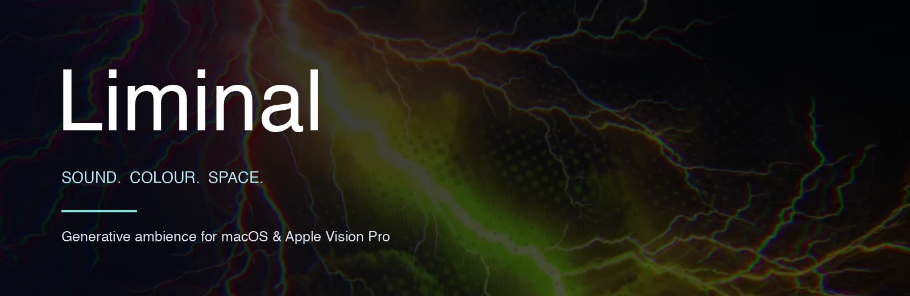

<p align="center">
  
</p>

<p align="center">
  <a href="docs/getting-started.md">Get started</a> ·
  <a href="docs/README.md">Documentation</a> ·
  <a href="docs/development.md#contributing">Contribute</a>
</p>

<p align="center">
  
  
  <a href="LICENSE"></a>
</p>

Liminal pairs evolving ambient music with surreal AI imagery, flowing visual effects, and fragments of archival film. Let it fill a window on your Mac or surround you on Apple Vision Pro. Press play and drift.

## See it in motion

[](https://cdn.jsdelivr.net/gh/pj4533/Liminal@main/docs/media/lofi-preview.mp4)

**[Play with sound · 8 seconds · 1.4 MB](https://cdn.jsdelivr.net/gh/pj4533/Liminal@main/docs/media/lofi-preview.mp4)** · [MP4 in the repository](docs/media/lofi-preview.mp4)

Captured from the macOS app at 69 BPM. Listen for the film dialogue over AJ Hall’s drums as the picture changes on the fill. Film excerpts come from the U.S. Air Force’s *UFO Interview* (1966). [Film source](https://archive.org/details/342-usaf-42990)

## An atmosphere that keeps changing

- **Two music modes** — slow Ambient scenes, or Lo-Fi with returning acoustic or electric piano hooks, plucked strings, and replies from soft mallets, bass recorder, or pipe organ, deep bass, and optional local 16-bar drum breaks. Lo-Fi chops short lines from the current film and repeats them on the beat.
- **Living imagery** — generated scenes blend through fluid effects that respond to the music.
- **Immersive space** — depth gives the imagery relief as it wraps around you on Vision Pro.
- **Traces of old film** — Vintage films from the Internet Archive weave texture, movement, and voices into the scene.
- **Make it yours** — choose an Ambient style, set the Lo-Fi BPM, or pin a scale in either mode. Adjust footage volume, visual intensity, and image-generation limits.

<details>
<summary>See the macOS app</summary>


</details>

## Get started

You’ll need Xcode with the macOS or visionOS SDK, and a [Gemini API key](https://aistudio.google.com/apikey) to generate new images.

```sh
git clone https://github.com/pj4533/Liminal.git
cd Liminal
cp Secrets.swift.template Liminal/Secrets.swift
open Liminal.xcodeproj
```

Add your key to the local `Liminal/Secrets.swift`, select the **Liminal** scheme and a **Mac or Apple Vision Pro** destination, then run. Never commit your key.

See the [setup guide](docs/getting-started.md) for environment-key configuration, requirements, and command-line builds.

## Explore the project

| Guide | What you’ll find |
| --- | --- |
| [Experience & controls](docs/experience.md) | Features, settings, and playback behavior |
| [Lo-Fi instrument recordings](docs/lofi-samples.md) | Sources and credits for all twelve sampled instruments |
| [Architecture](docs/architecture.md) | Music, image and rendering pipelines; dependencies |
| [Development](docs/development.md) | Tests, launch flags, scripts, and contribution guidance |
| [Design decisions](docs/decisions/README.md) | The reasoning behind the experience |

## License

[MIT](LICENSE) © PJ Gray. See [dependencies and media attribution](docs/architecture.md#dependencies) for third-party material.
