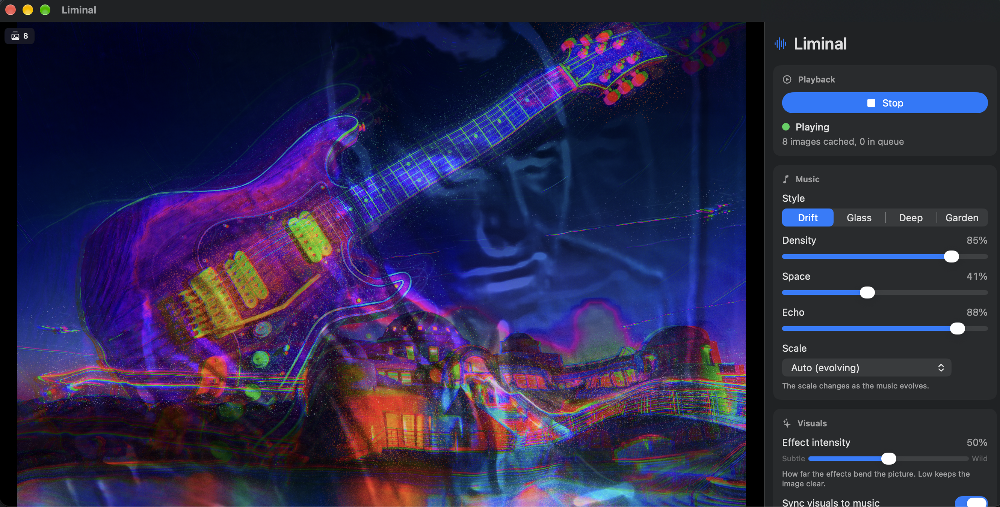

# Liminal

> Generative ambient audio-visual experience for macOS and visionOS


Liminal creates endless, evolving ambient soundscapes synchronized with AI-generated visuals that morph continuously. Run it in the background, let it play, and drift.

<p align="center">
  
</p>

## Features

- **Generative Audio**: eight-layer synthesized ambient engine (drone, pad, lead, keys, drips, air, grains, pluck) with evolving scenes, key drift, rare events and four styles (Drift, Glass, Deep, Garden); no samples. See `docs/decisions/music.md`
- **AI Visuals**: Gemini image generation (gemini-nano-banana-2.1, the latest model, 3:2 at 2K; hourly and daily spending cap) driven by a style/subject/transformation/palette prompt system for varied, photoreal-but-surreal imagery. See `docs/decisions/images.md`
- **GPU Effects**: one Metal fragment shader with Ken Burns motion, turbulence distortion, chromatic aberration, a family of 12 image transitions that hide the swap inside a surge of the live effects (picked without repeats, docs/decisions/transitions.md), hue shifts, ghost taps, stochastic bloom, feedback warping and a final vibrance stage that keeps colors vivid; a slow clarity cycle and a strain budget keep the image recognisable, scaled by the Effect intensity setting
- **Audio-visual coupling**: the music drives the visuals (note glow, scene intensity, chord-tied hue, ghost-tap burst on scene change) and each new image sends a mood (brightness, warmth, saturation, energy, mood words) back to the music. A "Sync visuals to music" switch turns the music-to-visuals direction off. See `docs/decisions/av-coupling.md`
- **macOS and visionOS**: a window with a control panel on macOS; on visionOS a control window plus one immersive space: a 3D shell that wraps 337.5 x 120 degrees around you (the image straight ahead, mirrored continuations to the sides, above and below), pushed into real depth from the ML depth map, with every effect on it (one 2048x2048 effects render). See `docs/decisions/spatial.md`
- **Archive footage**: while it is on, old film (Prelinger Archives on the Internet Archive, 1950-69, mostly black and white) is always woven subtly into the picture under every effect: a continuous stream of short pieces (8-30 s from random points of the cached films) that crossfade into each other, each with its own look, warp and level, some swelling slowly to more prominent, slowed to 0.6-0.85x. About a third of the pieces are plain blends; the rest let film and effects drive each other: the film bends the water (Undertow), splits the colour fringes along its contours (Fringe), feeds the trails (Wake), steers the hue waves (Aurora), folds the tone curve (Solar), lights the bloom (Glow), is embossed into the picture (Relief), is gradient-mapped through the picture's colours (Palette), plays in the picture's shadows (Shadowplay) or behind the subject on the depth map (Backdrop, visionOS), turns into a slow mandala (Kaleido) or halftone ink (Print). Effect intensity scales them; see `docs/decisions/footage-fx.md`. Some pieces bring the film's own sound, fading in and out slowly, very low (about 18-20 dB under the music), band-limited to 220 Hz-2.4 kHz and heard mostly through the music's reverb and echo; many stay silent. Clips are fetched politely and cached (1 GB, 12 clips) and replayed with new segments. See `docs/decisions/archive-video.md`
- **Indirect Control**: shape the experience through abstract sliders rather than direct manipulation

## Requirements

- macOS 26.0+ (deployment target) or visionOS (simulator or Apple Vision Pro)
- Xcode with the macOS and visionOS SDKs
- [Gemini API key](https://aistudio.google.com/apikey) (for image generation)

## Setup

1. Clone the repo
   ```bash
   git clone https://github.com/pj4533/Liminal.git
   cd Liminal
   ```

2. Open in Xcode
   ```bash
   open Liminal.xcodeproj
   ```

3. Configure your API key (either way)
   - Copy `Secrets.swift.template` to `Liminal/Secrets.swift` and fill in the key (gitignored; never commit it), or
   - Duplicate the `Liminal` scheme as `Liminal-Dev` and add a `GEMINI_API_KEY` environment variable under Run > Arguments

4. Build and run (Cmd-R). Pick the macOS or visionOS destination.

## Build from the command line

```bash
# macOS
xcodebuild -scheme Liminal -destination 'platform=macOS' build

# visionOS Simulator (list devices with: xcrun simctl list devices)
xcodebuild -scheme Liminal -destination 'platform=visionOS Simulator,name=Apple Vision Pro' build

# unit tests (macOS)
xcodebuild test -scheme Liminal -destination 'platform=macOS' -only-testing:LiminalTests
```

Never build for iOS destinations; the app targets macOS and visionOS only.

## Architecture

```
Audio                               Visual
-----                               ------
GenerativeEngine (facade)           Gemini -> ImageQueue / ImageStore (disk)
 MusicConductor (own queue, 20 ms)   -> ImageUpscaler (CoreML RealESRGAN on macOS,
 SceneDirector + 8 layers               MetalFX on device visionOS) -> 3:2 centre crop
 MixBus: Zita reverb, delay,         EffectsUniformsComputer (single source of truth)
 shimmer, limiter                     -> EffectsMetalView (macOS, MTKView)
        |                             -> OffscreenEffectsRenderer (visionOS, MRT stereo ->
        |  MusicState (lock-free)         DrawableQueue -> RealityKit shell)
        +-----> MusicReactor / MusicModulation -> uniforms
        <----- VisualMoodBuilder: setVisualMood / imageDidChange / setVisualActivity
```

Shader pipeline order (`Liminal/Shaders/EffectsRenderer.metal`): Ken Burns, distortion (turbulence, log-spherical, sinusoidal), stereo parallax and chromatic aberration, crossfade, hue shift (spatial, saliency, fractal), contrast/saturation, ghost taps, stochastic bloom, feedback warping, vibrance. `EffectsUniforms.swift` must match the Metal struct exactly. Images use one orientation convention: texture row 0 is the top. Platform details: `docs/PLATFORM_ARCHITECTURE.md`.

## Controls

| Control | Effect |
|--------|--------|
| **Style** | Drift, Glass, Deep or Garden music palette |
| **Density** | How many notes the pointed layers play |
| **Space** | Reverb size and dark halo |
| **Echo** | Audio delay and visual ghost-trail intensity |
| **Scale** | "Auto (evolving)" lets key and mode drift; choosing a scale pins it |
| **Effect intensity** | How far the effects bend the picture, Subtle to Wild (default 50%). The effects breathe between clear and wild stretches over minutes, and each new image starts clear. See `docs/decisions/effects-balance.md` |
| **Sync visuals to music** | Music drives hue, motion, bloom and ghost bursts (on by default) |
| **Debug effect** | Debug visualization of the effect (macOS panel) |
| **Cache only** | Skip generation and recycle cached images |
| **New images per hour / day** | Spending cap on Gemini image generation (default 20 / 50); past it, cached images are shown |
| **Clear All Images** | Wipes every cached image after confirmation and restarts generation |
| **Archive footage** | Old film always woven subtly into the scene (on by default); turning it off fades picture and sound out in 2 s |
| **Change speed** | Slow / Medium / Fast: a new piece of film drifts in every 20-30 / 12-20 / 8-12 s (default Medium) |
| **Footage audio** | Level of the film's own sound when a piece brings it, 0 = silent, 50% = the tuned default, 100% = +6 dB |
| **Clear Footage** | Deletes the cached films (keeps the ones on screen) |
| **Reset All Settings** | Restores defaults |

On macOS the panel scrolls, and Cache only, Clear All Images and Reset live in a "Storage & Settings" sheet (Cmd-,). The Archive Footage card (both platforms) also shows what is on screen, the cache size and the Prelinger credit. On visionOS all controls are in the control window (Playback, Music, Archive Footage, Visuals, Images & Storage), plus Enter/Exit Liminal (the immersive space) and a Depth slider for how far the relief comes toward you.

## Debug launch flags (DEBUG builds only, compiled out of Release)

Pass as launch arguments, for example `-LiminalAutoPlay YES`. Defined in `Liminal/Utils/DebugLaunchOptions.swift`.

**Any launch that uses these flags never calls Gemini** (no API spend from testing): it shows cached images, or the test card when the cache is empty. Add `-LiminalAllowGeneration YES` to deliberately allow generation; the in-app hourly/daily image limit still applies (`docs/decisions/images.md` D34).

| Flag | Effect |
|------|--------|
| `-LiminalAutoPlay YES` | Start playback at launch |
| `-LiminalAllowGeneration YES` | Let an automated launch generate new images (off by default) |
| `-LiminalOpenDome YES` | Open the immersive space automatically (visionOS) |
| `-LiminalShellYaw <deg>`, `-LiminalShellPitch <deg>` | Rotate the immersive scene so that direction faces the fixed simulator camera (negative angles as positive equivalents, e.g. 304) |
| `-LiminalShellHeadOffset "x,y,z"`, `-LiminalShellDepth <0...1>` | Imitate a head offset (parallax in the simulator) / override the Depth setting |
| `-LiminalDepthImage <png>`, `-LiminalShellCycle "img\|depth,..."` | Use Mac-made depth maps (the simulator's ML depth is all zeros) / cycle fixture images |
| `-LiminalHideControls YES`, `-LiminalShellTextureStereo YES` | Close the controls window once the space is open / old per-eye texture parallax A/B |
| `-LiminalFreezeTime <s>` | Pin the effect clock for deterministic screenshots (bypasses coupling) |
| `-LiminalPerfLogInterval <s>` | Interval of the PERF log lines (default 1) |
| `-LiminalPerfSplitPasses YES` | Legacy split-pass option (no-op since the direct-drawable render) |
| `-LiminalTestPattern YES` / `-LiminalTestImage <path>` | Show a generated orientation test card / a given image. If `<path>` is a directory, its images are cycled on the image schedule (real transitions on known images; the macOS app is sandboxed, so use a path it can read) |
| `-LiminalImageInterval <s>` | Seconds between images for this launch (at least 4), not saved; e.g. 15 to see many transitions |
| `-LiminalForceStereoFlatDepth YES`, `-LiminalForceMonoMaterial YES` | Force flat depth / the mono fallback material |
| `-LiminalNoEffects YES` | Bypass all effects |
| `-LiminalSyncLog YES` | One SYNC log line per second (coupling state) |
| `-LiminalSyncStrength <x>` | Exaggerate the music-to-visuals coupling for tuning |
| `-LiminalEffectIntensity <0-1>` | Override the Effect intensity setting for this launch without changing it |
| `-LiminalTransitionStyle <name>` | Use this transition style for every image change (tide, facets, prism, rainbow, kaleidoscope, whirlpool, dive, afterimage, ripple, solarize, melt, shatter, classic) |
| `-LiminalTransitionSeed <n>` | Pin the transition seed too (same spec as `scripts/tx-clip.sh --style/--seed`) |
| `-LiminalVideoForce YES` | Archive footage pieces at the Fast change speed whatever the setting |
| `-LiminalVideoLook <name>`, `-LiminalVideoSeed <n>` | Every piece in this look (phantom, imprint, window, emerge) / pin the footage weaver's seed |
| `-LiminalVideoMode <recipe>` (alias `-LiminalFootageMode`) | Every piece in this footage recipe: a look or an interaction mode (undertow, wake, facets, fringe, aurora, solar, palette, shadowplay, backdrop, kaleido, relief, glow, print) |
| `-LiminalVideoFile <mp4>`, `-LiminalVideoMix <0-1>` | Play a local clip, no network / one hour-long piece at a constant mix (stills) |
| `-LiminalVideoOffline YES`, `-LiminalVideoOff YES` | Cache only, no Internet Archive requests / no footage at all |
| `-LiminalVideoOffAt <s>` | Turn the Archive footage setting off that many seconds after footage starts (fade-out check), not saved |
| `-LiminalControlsScroll archive`, `-LiminalControlsWidth <pt>` | Scroll the control panel/window to the Archive Footage card / visionOS controls window width (layout screenshots) |

## Scripts (`scripts/`)

| Script | Purpose |
|--------|---------|
| `perf-run.sh` | Repeatable visionOS Simulator capture: launches with the debug flags, collects fps and GPU timing, writes a JSON summary and screenshot |
| `shader-bench.sh` | Deterministic Mac-GPU benchmark of the visionOS eye pass, with interleaved A/B of two shader files and parity PNG comparison |
| `sim-tap.sh X Y` | Click the visionOS Simulator at 3840x2160 screenshot pixel coordinates via Peekaboo |
| `sim-drag.sh` | Drag in the Simulator (needed for sliders) |
| `vibrance-eval.sh IN OUT` | Offline vibrance evaluation of the effect pipeline over a folder of images (`vibrance-check.py` checks the result) |
| `render-music.sh`, `check-music.py` | Offline render and analysis of the music engine; `ARCHIVE=<mp4>` mixes one footage piece's sound in |
| `analyze-archive-audio.py` | Level, spectrum, fades and limiter check of the archive sound in a render |
| `archive-curate.py`, `archive-fetch-fixture.sh` | Build the bundled Prelinger seed list / download one fixture clip to a scratch folder |
| `av-coupling-check.sh` | Offline check of the audio-visual coupling |

Simulator automation notes: `docs/research/visionos-sim-automation/README.md`.

## Documentation

Decision records, with a review index: `docs/decisions/README.md`. Plans: `docs/plans/`.

## Dependencies

- [AudioKit](https://github.com/AudioKit/AudioKit), AudioKitEX and SoundpipeAudioKit: audio synthesis and effects

## License

MIT © PJ Gray
