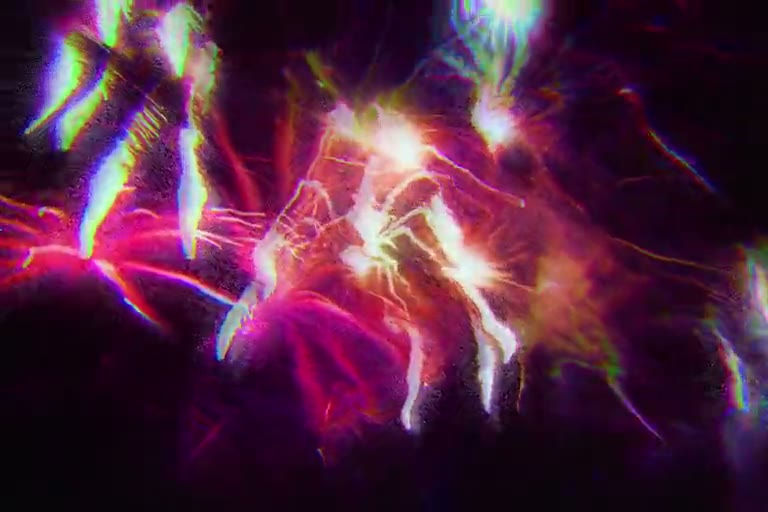

<p align="center">
  
</p>

<p align="center">
  <a href="docs/getting-started.md">Get started</a> ·
  <a href="docs/README.md">Documentation</a> ·
  <a href="docs/development.md#contributing">Contribute</a>
</p>

<p align="center">
  
  
  <a href="LICENSE"></a>
</p>

Liminal pairs evolving ambient music with surreal AI imagery, flowing visual effects, and fragments of archival film. Let it fill a window on your Mac or surround you on Apple Vision Pro. Press play and drift.

## See it in motion

[](https://github.com/pj4533/Liminal/blob/main/docs/media/lofi-preview.mp4)

**[Play with sound · 17 seconds · 2.5 MB](https://github.com/pj4533/Liminal/blob/main/docs/media/lofi-preview.mp4)**

Lo-Fi at about 69 BPM with AJ Hall’s drums and API pictures from public libraries and archives, recorded by the app itself running in the visionOS Simulator. Pictures from the Library of Congress and the National Archives come in through the app's public-domain image source, and no AI image is generated. The picture breaks up into drifting macroblocks as the drum fill builds, then cuts to the next image on the first hit of the new drum loop. Seven seconds later the chop beat begins: dialogue from *History of Marijuana Legislation, Part One* (KCRA-TV footage via the Center for Sacramento History) is cut into word pieces and played on the beat over the drums, bass and pad, with the film's own soundtrack far behind as an effected bed. [History of Marijuana Legislation](https://archive.org/details/VAM026) · Pictures: [*Oil Refinery in the Sunset*](https://commons.wikimedia.org/wiki/File:OIL_REFINERY_IN_THE_SUNSET_-_NARA_-_546384.jpg), John Vachon (Documerica, National Archives, public domain) · [*World's Fair. Fireworks IV*](https://www.loc.gov/item/2018750453/), Gottscho-Schleisner (Library of Congress, no known restrictions on publication)

## An atmosphere that keeps changing

- **Two music modes** — drift through slow Ambient scenes or play Lo-Fi. Its bass is a warm dub and boom-bap sub with a hard slap locked to the drummer's kicks and occasional dub throws, in three tones that change every 16 bars. Over it, a soft held pad sits under the melody, played by twenty sampled acoustic programs: pianos, plucked strings and guitars that strum and fingerpick. With AJ Hall's Slow Burn drum packs installed locally (Vol. 1–4, 100 breaks), each 16-bar take is a fresh recorded break near the set tempo, played through its original fills.
- **Film dialogue, chopped like an MPC** — each 16-bar loop takes a fresh line from the films and cuts it into word and syllable pieces. The pieces repeat, pause, reorder and land on the beat in every bar, with echo throws, reversed pickups and a long dark room. The chops sit inside the music while the original soundtrack plays far behind as an effected bed.
- **AI or API pictures** — a picker switches the imagery between Gemini generation (AI) and curated public-domain and openly licensed pictures fetched from library, museum and space-agency APIs (API): roadside neon and linen postcards, 1970s documentary photographs, Apollo-era Earth, aurorae and galaxies, photochroms, fungi, woodblock prints and Hudson River landscapes. API mode needs no key and never calls Gemini. Every picture carries its title, creator, institution and licence in the controls. [How API mode works, every source and how to add one](docs/image-sources/README.md) · [credits](docs/experience.md#api-image-sources).
- **Record** — a button under Play records the rendered picture and the final mix (HEVC at 60 Hz, lossless 24-bit audio) straight from the renderer, not the screen, and saves the movie to Photos. Works on macOS and Vision Pro. [How recording works](docs/recording.md).
- **Living imagery** — generated scenes blend through effects that respond to the music. In Lo-Fi, every image change is a drop: through the drum fill the old picture tears, crushes, smears or scrambles through one of nineteen glitch styles, then cuts clean to the new image on the first hit of the next loop.
- **Immersive space** — depth gives the imagery relief as it wraps around you on Vision Pro.
- **Traces of old film** — Ten pinned films include *Thinking Machines* and Stanford’s *Hear Here*, a 1969 demonstration of speech recognition. Two more slots rotate through discoveries from the Internet Archive. [Film list and credits](docs/experience.md#pinned-films-and-rotating-discoveries)
- **Make it yours** — choose an Ambient style, set the Lo-Fi BPM, or pin a scale in either mode. Adjust footage volume, visual intensity, and image-generation limits.

<details>
<summary>See the macOS app</summary>


</details>

## Get started

You’ll need Xcode with the macOS or visionOS SDK, and a [Gemini API key](https://aistudio.google.com/apikey) to generate new images in AI mode. API mode needs no key.

```sh
git clone https://github.com/pj4533/Liminal.git
cd Liminal
cp Secrets.swift.template Liminal/Secrets.swift
open Liminal.xcodeproj
```

Add your key to the local `Liminal/Secrets.swift`, select the **Liminal** scheme and a **Mac or Apple Vision Pro** destination, then run. Never commit your key.

See the [setup guide](docs/getting-started.md) for environment-key configuration, requirements, and command-line builds.

## Explore the project

| Guide | What you’ll find |
| --- | --- |
| [Experience & controls](docs/experience.md) | Features, settings, and playback behavior |
| [Lo-Fi instrument recordings](docs/lofi-samples.md) | Sources and credits for all twenty sampled programs |
| [Architecture](docs/architecture.md) | Music, image and rendering pipelines; dependencies |
| [Recording](docs/recording.md) | The Record button: what is captured, formats, how frames and audio are taken from the renderer, Photos permission, measurements |
| [Image sources](docs/image-sources/README.md) | API image mode: the pipeline, every source and provider, adding a source, research history |
| [Development](docs/development.md) | Tests, launch flags, scripts, and contribution guidance |
| [Design decisions](docs/decisions/README.md) | The reasoning behind the experience |

## License

[MIT](LICENSE) © PJ Gray. See [dependencies and media attribution](docs/architecture.md#dependencies) for third-party material.
