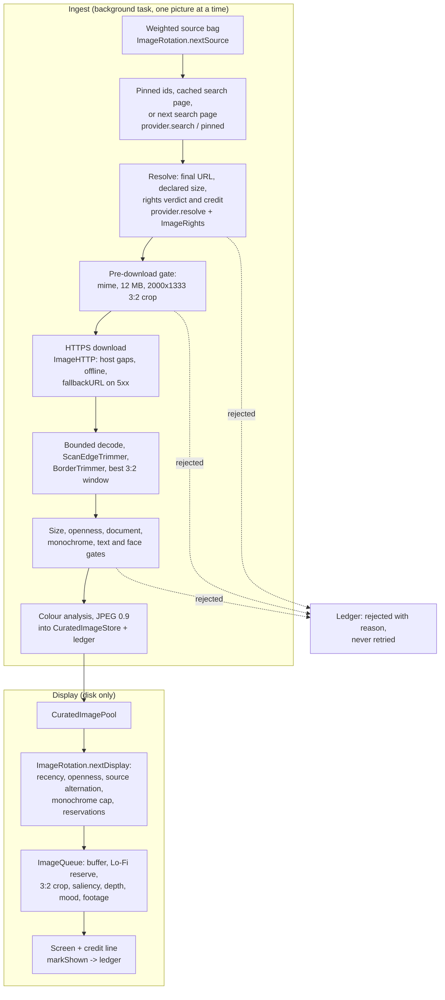

# Image sources: AI and API

[← Documentation](../README.md) · [Pipeline](pipeline.md) · [Sources](sources.md) · [Providers](providers.md) · [Adding a source](adding-a-source.md) · [Research history](research-history.md)

Liminal can get its pictures in two ways. A picker labelled **Images** chooses between them:

- **AI** generates surreal 3:2 2K images with Gemini and caches them on disk. When generation is capped or unavailable, it reuses the cache. This is the default.
- **API** shows curated public-domain and openly licensed pictures from library, museum and space-agency APIs: the Library of Congress, NASA, Wikimedia Commons, the Cleveland Museum of Art, the Met, the Boston Public Library (through Digital Commonwealth) and the Art Institute of Chicago. API mode needs no key and never calls Gemini.

This folder documents API mode completely: how a picture travels from an institution's API to the screen, every source and provider, how to add one, and how the sources were found. It was written on 2026-11-21 from the code in `Liminal/Visual/ImageSources/` and `image-collections.json`. Where an older plan or research note disagrees with the code, the code is right.

| Page | What it covers |
|---|---|
| [pipeline.md](pipeline.md) | The whole process end to end: source rotation, search paging and the ledger, resolving, download, decode, trimming, the openness, text, face and monochrome gates with their thresholds, 3:2 framing, the pool on disk, display rotation, Lo-Fi timing, credits, concurrency, log lines, debug flags and verification |
| [sources.md](sources.md) | Every source in `image-collections.json`: what it searches and shows, measured resolution, the route to the high-resolution file, rights, weight, monochrome, pins, credits |
| [providers.md](providers.md) | One section per provider (`loc`, `nasa`, `wikimedia`, `cma`, `met`, `dc`, `aic`, `si`): endpoints, auth, paging, fields, the high-resolution trick, rate limits and known pitfalls |
| [adding-a-source.md](adding-a-source.md) | How to research a collection, write its JSON entry (every field), write a provider, test it with fixtures, and verify it live without touching the user's pool |
| [research-history.md](research-history.md) | How the sources were found, from OpenPics to the 2026-11-21 research passes, and what was rejected and why |

Decisions and measurements: [`decisions/images.md`](../decisions/images.md) D36-D44. The original plan: [`plans/image-api-mode.md`](../plans/image-api-mode.md) (implemented; parts have changed since, see the decisions).

## What the user sees

- **The picker.** "Images: AI | API" sits directly under the Ambient / Lo-Fi picker, in the macOS control panel and the visionOS control window (`ImageSourceControls`, setting `visual.imageSource`, default AI). The caption under it reads "Curated public-domain pictures from libraries, museums and NASA. No generation." in API mode.
- **Switching** keeps the picture that is on screen. The next image change (the timer in Ambient, the drum boundary in Lo-Fi) shows a picture from the new source. Switches are chained one after another (`VisualEngine.setImageSource`), so quick toggling always ends on the source the picker shows.
- **The credit line.** In the **Images & Storage** section of the controls, **Now showing** gives the picture on screen as "Title · Creator, date · Institution · Licence" and a link, "View at <institution>", to the item's page (`ImageCreditLine`). The credit is never drawn on the picture itself.
- **The status row** (`APIStatusRow`) reads, for example, "Curated collections: 7 of 7 sources online". Here "sources" counts providers that are not backing off. It turns yellow when some are, and reads "Offline, showing saved pictures" or "Collections not answering, showing saved pictures" when none are reachable.
- **Status messages** appear when the pool is empty: "Fetching the first pictures…", "Offline and no saved pictures yet." or "The image collections are not answering right now."
- **Clearing.** In API mode the clear button reads **Clear Curated Pictures**. It asks "Delete all N curated pictures (size)?" and clears only the API pool and its ledger, never the AI cache. The usage line reads "N curated pictures saved, size".
- **Hidden in API mode:** Cache Only and the Gemini image limits, which only apply to generation.

## No Gemini spend

API mode never sends a Gemini request, never calls `GenerationBudget.check()` or `record()`, and never touches the prompt history:

- `ImageQueue.start()` starts the API feed and returns before any generation path is reached.
- `requestImage` and the generation task refuse unless the active source is AI, and a Gemini result that lands after a switch is dropped.
- The AI cache is never shown in API mode. The fallback order is queued pictures, then the API pool on disk, then the bundled standby art.

Automation launch flags block Gemini (`DebugLaunchOptions.blocksImageGeneration`), but they do not block the free public APIs. The `-LiminalImage*` flags count as automation flags too, so an API verification run can never spend the Gemini budget. Every verification run in D41-D44 logged 0 `[Gemini]` requests.

## The flow at a glance

The two halves never wait on each other. Ingest only adds to the pool, and only while fewer than 12 never-shown pictures are waiting. Display only reads the pool on disk. A slow or offline network therefore never delays an image change: in Lo-Fi the reserve deadline works exactly as it does with the AI cache, and offline the rotation keeps going from what is stored.

## Where the code is

All of it is under `Liminal/Visual/ImageSources/`:

| File | Role |
|---|---|
| `ImageSource.swift` | The AI / API enum, its setting key and the DEBUG override |
| `image-collections.json`, `ImageCollections.swift` | The approved sources, defaults (sizes, gaps, thresholds) and licence allowlist, and the types that decode them |
| `ImageProvider.swift`, `ImageCandidate.swift` | The provider protocol, the shared rights and credit check, the registry (`ImageProviders.all`), loose JSON helpers, and candidate and resolved-image types |
| `Providers/*.swift` | One adapter per institution: `LOCProvider`, `NASAProvider`, `WikimediaProvider`, `ClevelandProvider`, `MetProvider`, `DigitalCommonwealthProvider`, `ArticProvider`, `SmithsonianProvider` |
| `ImageHTTP.swift` | The one HTTPS client: paced per host, ephemeral, generic User-Agent |
| `ImageRights.swift` | The rights rule and licence labels and links |
| `ImageOpenness.swift` | The room-for-the-film score, its gates and the 3:2 window search |
| `ScanEdgeTrimmer.swift` | Film rebate trim for scanned slides (`Liminal/Visual/BorderTrimmer.swift` handles white borders) |
| `ImageRotation.swift` | The two seeded choices: next source to ingest from, next picture to show |
| `CuratedImagePool.swift` | The pool on disk, ledger, eviction and launch sweep |
| `CuratedImageFeed.swift` | The ingest loop and the display entry points |
| `ImageSourceCredit.swift` | The credit record stored with each picture |

The UI is in `Liminal/ImageSourceControls.swift` (picker, credit line, status row) and `Liminal/ClearImagesSection.swift`. `ImageQueue` (`startAPIFeed`, `reserveForFill`, `switchSource`, `clearAPIPool`) connects the feed to the rest of the visual pipeline, which is the same for both sources. Tests are in `LiminalTests/ImageAPIModeTests.swift`, with fixtures in `LiminalTests/Fixtures/ImageAPI/`.
