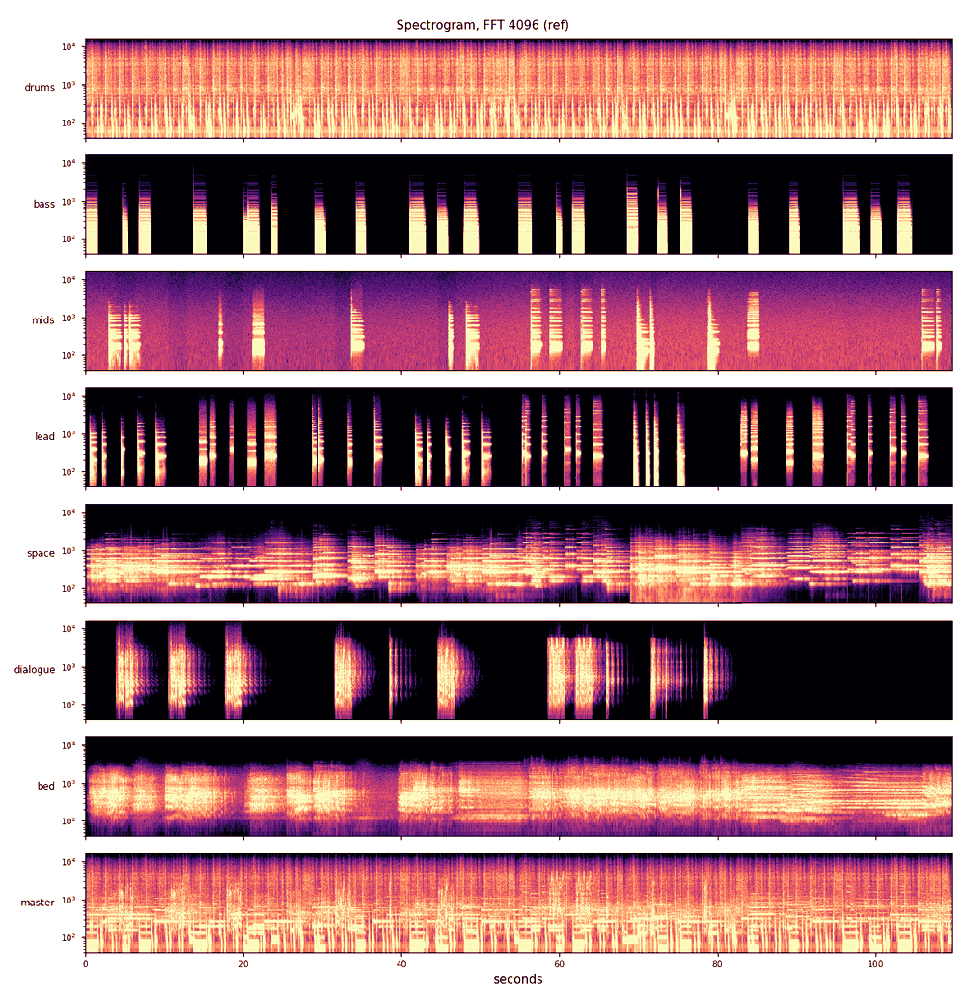
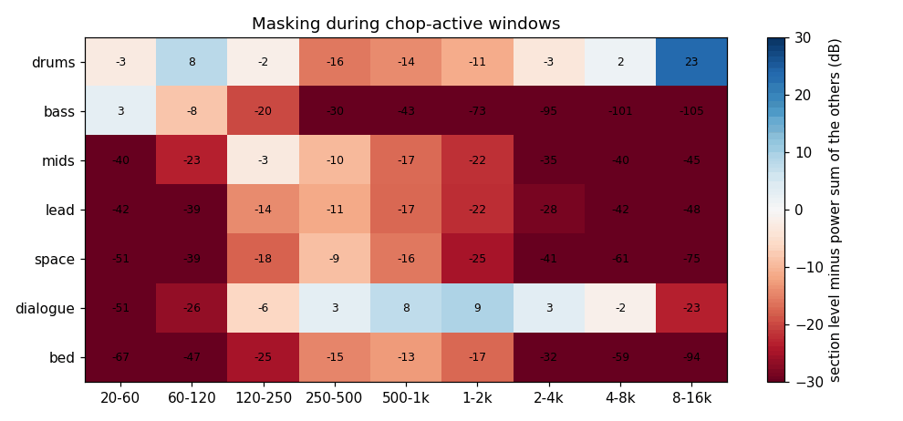
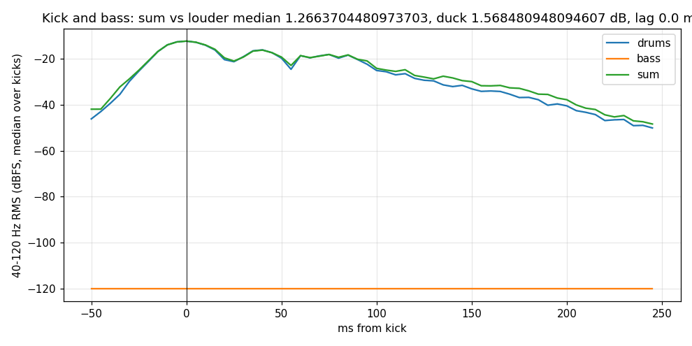
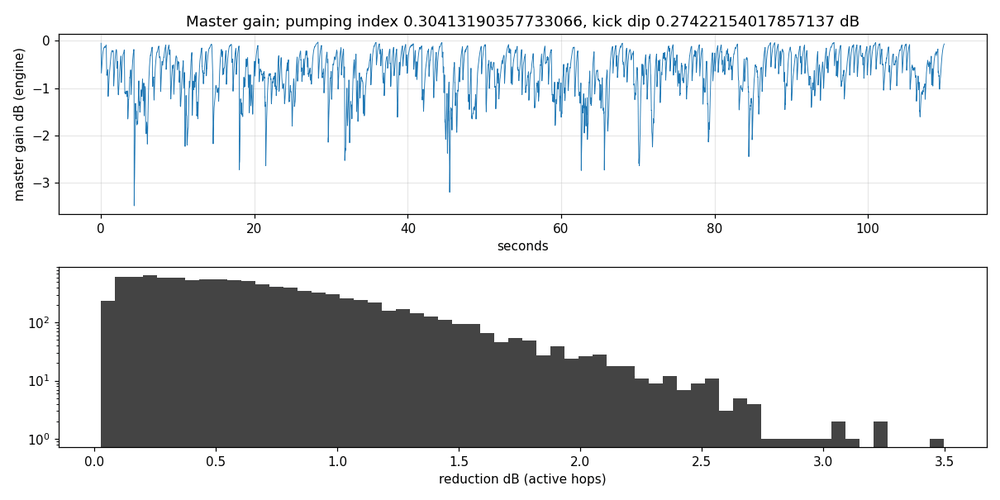
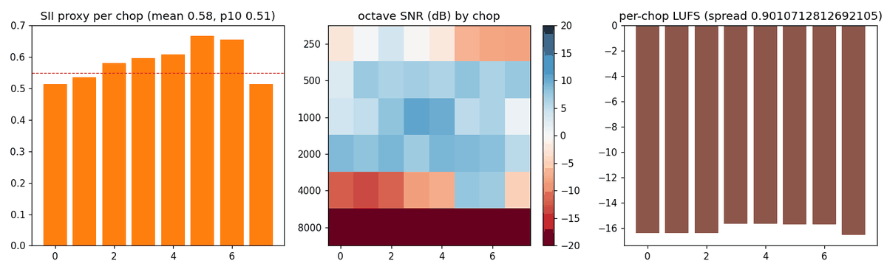
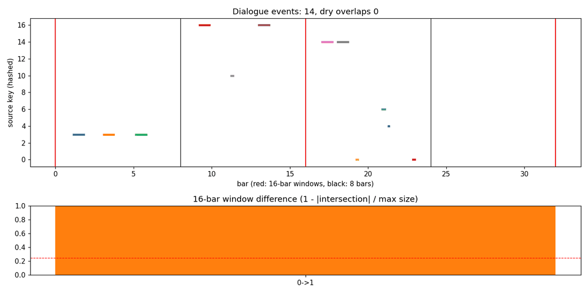

# Mix verification

How to measure a Lo-Fi mix without listening, read the figures, and decide pass or fail. Written for an engineer or agent who has the repository and has not seen the MPC chopping and mix work. The method was designed in [the plan](plans/mpc-chopping.md) (section 9) and the [mix engineering notes](research/lofi-mix-engineering.md) (sections 8 and 9). This document describes what the tools in `scripts/` actually do.

Contents: [what it verifies](#what-this-verifies-and-what-it-cannot) · [prerequisites](#prerequisites) · [quick start](#quick-start) · [what a capture contains](#what-a-capture-contains) · [measurements](#measurements) · [criteria](#criteria) · [reading the figures](#reading-the-figures) · [before and after](#before-and-after) · [dialogue cadence and lead time](#dialogue-cadence-and-lead-time) · [adding a stem or a diagnostic](#adding-a-stem-or-a-diagnostic) · [troubleshooting](#troubleshooting) · [where results live](#where-results-live)

## What this verifies and what it cannot

A capture renders the Lo-Fi graph offline on the sample clock (no audio device, no app launch, no network, no Gemini) and writes every stem and several internal taps as float WAV files. The analysis then measures them against thresholds in `scripts/mix-criteria.json`.

It checks:

- loudness, true peak, peak-to-loudness ratio, crest and the master's gain reduction (is the mix loud, safe and not squashed or pumping);
- spectral balance and masking between the seven sections (does each part have room);
- the low end (bass and kick agreement, mono compatibility, nothing under 25 Hz);
- proxies for dialogue intelligibility and for the film bed's audibility;
- the dialogue performance: whether it changes at least every 16 bars, whether it rests, whether events overlap, and whether each cue was planned before its deadline;
- that the stems add up to the bus they feed (routing).

It cannot check, and a person must still listen for:

- whether a chop starts on a syllable and ends cleanly, and whether the words are actually understood (the SII proxy is a band-audibility estimate, not a speech test);
- whether the theme return is recognised as the same tune (the figure is an onset-envelope correlation and a level margin);
- whether punch, groove and swing feel right, whether the limiter is audible, and whether the reverb tail smears the next note;
- taste: the character of the film bed, the saturation, the lo-fi texture.

The [audition files](#before-and-after) exist for that listening step. They are loudness matched so that level does not bias the comparison. A passing report means the measurable failures are absent. It does not mean the mix sounds good.

## Prerequisites

- macOS with Xcode (the capture is a unit test, `LiminalTests/LofiMixRenderTests`, run with an explicit `platform=macOS` destination inside `scripts/check-lofi.sh`). Never run it for iOS.
- `ffmpeg` on the `PATH`, the independent loudness and true-peak meter. The capture checker (`scripts/analyze-lofi.py`, run at the end of `check-lofi.sh`) stops without it (`FFmpeg is required for independent loudness and true peak`). `mix-report.py` alone still runs on an existing capture without it: `loudness.ffmpeg` then carries an error, the ffmpeg half of C-M2 is skipped, and the 16x reconstruction is used.
- Python 3 with NumPy, SciPy and Matplotlib (checked here with NumPy 2.2, SciPy 1.16, Matplotlib 3.10).
- `Liminal/Secrets.swift` (git-ignored). Copy `Secrets.swift.template` if it is missing. The placeholder is enough, because a capture never calls Gemini.
- The private drum pack (`Liminal/SlowBurnDrums/` and `Liminal/Audio/Lofi/SlowBurnBeatGrid.json`, both git-ignored) for every command below that passes `--private-drums`. In a git worktree these files are absent; clone them in from the main checkout with `cp -c` (APFS clone, instant). Never commit them.
- Cached archive footage for `--film-reel`, `--same-film` and `--cached-footage`. The captures use audio-bearing clips already in the app's archive cache (`ArchiveClipStore`, under Application Support). With none cached the test stops with `No cached film reel with audio`. `--no-footage` needs no cache.
- Disk: one 32-bar capture is about 0.9 GB (about 23 WAV files of 42 MB each at 109 s, 48 kHz float stereo), a 64-bar capture about twice that, and `--auditions` adds about 0.4 GB. Captures live outside the repository: the harness refuses an output directory inside the checkout.
- `DD` (derived data path). The scripts build and test into `$DD` and fall back to `/private/tmp/liminal-overhaul-mac`. Parallel sessions must not share one `DD`. An xcodebuild needs its package cache, so the first run in a new `DD` is slower; copying `SourcePackages` from an existing derived data folder avoids a re-download.
- Never commit a capture, a WAV, an audition file or `report/` output. Keep them in the session scratchpad or another directory outside the repository.

### The capture lock

Only one capture can run at a time on a machine, because the test host reads its configuration from one shared file, `/private/tmp/liminal-lofi-audio-config-<uid>.json`. `scripts/check-lofi.sh` creates it exclusively and removes it when the capture ends. If another capture holds it, the script prints `Waiting for another Lo-Fi capture to release ...` and polls every five seconds. `--wait-lock SECONDS` (default 1200) sets how long it waits before giving up. So two sessions can both start captures; the second queues behind the first. Analysis (`mix-report.py`) needs no lock and can run at any time.

## Quick start

Set a scratch directory and a derived data path first. Every path below lives outside the repository.

```sh
S=/private/tmp/claude-501/-Users-pj4533-Developer-Liminal/b8f97122-abd8-4cd6-b289-17658fba4b13/scratchpad
DD=$S/dd-docs
```

(Replace `S` with any writable directory; the baseline convention below only needs the layout, not that path.)

### One command: capture and report

```sh
DD=$S/dd-docs scripts/mix-report.sh --out $S/docs-ref --private-drums --film-reel --bars 32 --seed 1042 --bpm 70 --baseline $S/baseline/ref
```

This captures the `ref` case, then runs the report. The capture renders 110 s of audio; the analysis, plots and baseline comparison took 35 s (plus the build and the capture itself). `--out` must name an empty directory outside the repository. Options consumed by `scripts/mix-report.sh` are `--out`, `--baseline DIR`, `--strict`, `--no-plots` and `--case NAME`. Everything else goes to `scripts/check-lofi.sh` (`--private-drums`, `--film-reel`, `--same-film`, `--cached-footage`, `--footage FILE`, `--no-footage`, `--bars 4|8|12|16|32|64`, `--seed`, `--bpm 58-82`, `--scale`, `--drum-name`, `--next-drum-name`, `--postroll-beats`, `--wait-lock`, `--hook KEY=VALUE`).

Exit status: nonzero if the capture's own routing or peak check fails (`analysis.json`), or, with `--strict`, if a fail-level criterion fails. The last lines of the output are the verdict table, then `N pass, N fail, N warn, N skipped; strict failures: ...`.

### Analysis only, on an existing capture

```sh
python3 scripts/mix-report.py $S/docs-ref --baseline $S/baseline/ref --auditions
```

This re-reads the WAVs and writes `report/` again (about 10 s of measurement, then the plots, then the audition files). Add `--strict` to gate the exit status, `--no-plots` to skip the figures, `--case NAME` when the directory is not named after its case, `--criteria FILE` to try other thresholds. Use this after editing `scripts/mix-criteria.json` or `scripts/mixlib/`.

```sh
python3 scripts/mix-report.py --self-test
```

The self-test builds synthetic captures in memory (known gains, known failures, tampered fingerprints) and checks that every measurement and criterion fails when it should and passes when it should. It exits 0 and prints `self-test passed`. Run it after any change to the analysis.

```sh
python3 scripts/mix-report.py --print-criteria-md
```

Prints the criteria table (reproduced in [Criteria](#criteria)) from `scripts/mix-criteria.json`.

### The matrix

```sh
DD=$S/dd-docs scripts/mix-matrix.sh --out $S/matrix-docs --baseline $S/baseline [--strict] [--prune-wavs]
```

Runs the five cases one after another (all with `--private-drums`), then writes `matrix-summary.md` and `.json`:

| Case | Options | Purpose |
|---|---|---|
| `ref` | `--film-reel --bars 32 --seed 1042 --bpm 70` | the reference case |
| `long` | `--film-reel --bars 64 --seed 7 --bpm 62` | slow tempo, two full takes, development across 16-bar windows |
| `fast` | `--film-reel --bars 32 --seed 2025 --bpm 80` | fast tempo |
| `same` | `--same-film --bars 64 --seed 1042 --bpm 70` | one film repeated at the same offset: tests that the performance changes when the source does not |
| `nofilm` | `--no-footage --bars 16 --seed 1042 --bpm 70` | silence routing; footage criteria skip |

`--cases ref,same` runs a subset. `--prune-wavs` deletes the WAVs of `long`, `fast` and `nofilm` once their reports exist (the reports and figures stay). A case directory that already holds a capture is reported on again instead of captured again; one with a pruned report is kept; one without a manifest (a capture that failed part way) is cleared and captured again. Extra `check-lofi.sh` options follow a literal `--`. `--baseline DIR` compares each case with `DIR/<case>/report`.

`matrix-summary.md` has counts per case, a grid of criterion status by case, the failing fail-level criteria per case (the to-do list), the warn-level criteria that warn, and baseline deltas. Under `--strict` the exit status is nonzero when any case has a strict failure.

### Baselines

Convention: the baseline of the unmodified audio code lives in `$S/baseline/<case>/`, each directory a capture with its own `report/`. `--baseline` accepts either that directory or its `report` subdirectory, and the audition builder reads `master.wav` from it. The baseline in `$S/baseline` was captured at commit `caa36b1` (the first commit with the capture harness, before any audio change). `--baseline` expects the same case and, for a meaningful comparison, the same seed, BPM and bars: the report prints `warning: no baseline report at ...` when the file is missing, and still runs.

To capture a new baseline from another commit, check that commit out in its own worktree (it must contain `scripts/mix-report.sh` and the harness), clone in the private files, and run the same command there:

```sh
git worktree add $S/wt-baseline caa36b1
cp -c Liminal/Secrets.swift $S/wt-baseline/Liminal/
cp -cR Liminal/SlowBurnDrums $S/wt-baseline/Liminal/
cp -c Liminal/Audio/Lofi/SlowBurnBeatGrid.json $S/wt-baseline/Liminal/Audio/Lofi/
cd $S/wt-baseline
DD=$S/dd-baseline scripts/mix-report.sh --out $S/baseline/ref --private-drums --film-reel --bars 32 --seed 1042 --bpm 70
cd - && git worktree remove --force $S/wt-baseline
```

(Run the `cp` lines from the main checkout.) The capture records the checkout's `gitRevision` and a hash of any uncommitted diff in the manifest, so a baseline is traceable. Use that checkout's own copy of the scripts, because the report is computed by the commit that captured it. An old baseline report may lack criteria added later; `--baseline` then shows `-` for them.

## What a capture contains

A capture directory holds one WAV per tap, `manifest.json`, `score.json`, `analysis.json`, `ffmpeg-ebur128.log`, optional extra files, and after the report a `report/` folder.

### Signal flow and tap points

Every WAV is 32-bit float stereo at the manifest's sample rate (48 kHz), the same length (`frames`), sample aligned. Names in brackets are taps.

```
LofiDrumTake  drum bus chain (per take, offline) ---> drums player ............ [drums] ----------------+
LofiRenderer  bass chain -----------------------------> bass player ............ [bass] ----------------+
              lead chain  ---> dry player  ---> dryFader (duck target) ......... [dry] -----------------+
              mids chain  ---> texture player -> textureFader (duck target) .... [texture] -------------+--> Mixer
              space chain + duck -> wet player -> wetFader (duck target) ....... [wet] ------------------+   |
ArchiveVoice  chops: chopDry ........................................ [dialogue-dry] ---+               |   v
                     chopEcho -> echo band -> chopEchoReturn --+                         +--> chopOutput ->  output Fader
                     chopRoom -> room band -> chopRoomReturn --+-> chopWet [dialogue-fx]-+   [dialogue-chops]   [lofi]
                                                                                                           |
ArchiveVoice  bed:  film source -> Fader [film-soundtrack]                                                  |
                    -> high-pass -> low-pass x2 -> presence dip -> phaser [bed-post] -> strip (level,        |
                    reverb and delay sends, pan) -> MixBus: direct [footage-dry], tape delay                 |
                    [footage-delay], room [footage-room] -> output [footage] ------------------------------+
                                                                                                           |
pre-master = lofi + footage   [pre-master] -> glue (Apple, bypassed in the lofi profile) [glue]
          -> trim [master-in] -> Apple limiter (bypassed in the lofi profile)
          -> LofiMasterFinisher: glue, soft clip, true-peak limiter  (gain-reduction trace -> master-gr.csv)
          -> output [master]
```

`fx-color-raw.wav`, `fx-echo-raw.wav` and `fx-room-raw.wav` are renderer working files written by the test; the analysis does not read them. They can be ignored (and deleted from a kept capture to save 120 MB).

### Tap table

| File | Tap point | Used for |
|---|---|---|
| `drums.wav` | drum player, after the per-take drum bus chain | drums section |
| `bass.wav` | bass player, after the bass chain | bass section |
| `dry.wav` | lead fader (lead chain, before the dry send) | lead section |
| `texture.wav` | texture fader (mids chain) | mids section |
| `wet.wav` | wet fader (space: reverb and delay returns of the lead and mids, after the space chain and duck) | space section |
| `dialogue-chops.wav` | chop output fader, after the chop effects (dry plus echo and room returns) | dialogue section |
| `dialogue-dry.wav` | chop dry path only, before the effects | processed-minus-dry level (M11) |
| `dialogue-fx.wav` | echo and room returns only, before the cue fader | auditioning the effects |
| `film-soundtrack.wav` | film source after its fader, before the bed filters | auditioning the unfiltered film |
| `bed-post.wav` | after the bed's high-pass, two low-passes, presence dip and phaser, before the strip's sends | bed roll-off (C-B9 prefers it) |
| `footage-dry.wav`, `footage-delay.wav`, `footage-room.wav` | the three returns of the footage mix bus | bed direct-to-wet (M12) |
| `footage.wav` | footage mix bus output (the whole treated bed) | bed section |
| `lofi.wav` | Lo-Fi bus output: drums, bass, dry, texture, wet and dialogue-chops summed | routing identity (M16) |
| `pre-master.wav` | master bus input: `lofi` plus `footage` | routing identity, inferred gain trace |
| `glue.wav` | after the Apple glue compressor (a copy of the input in the lofi profile) | reference |
| `master-in.wav` | after the master trim, the input of the finisher | reference |
| `master.wav` | master output | everything on the master |

Older captures lack the `bed-post`, `dialogue-dry` and `master-in` taps and the report still runs; the checks that need them skip or fall back.

### Section map

`manifest.sections` maps the seven sections the report is organised by to stems. `Capture.section_signal` sums the stems of a section.

| Section | Stem | What it is |
|---|---|---|
| drums | `drums` | the private drum take |
| bass | `bass` | the bass voice |
| mids | `texture` | chord stabs, answers and texture |
| lead | `dry` | the melody (dry part of the lead) |
| space | `wet` | reverb and delay returns of the music |
| dialogue | `dialogue-chops` | the chopped archive dialogue |
| bed | `footage` | the treated film soundtrack bed |

Plots and matrices use the order drums, bass, mids, lead, space, dialogue, bed, with a fixed colour per section.

### Manifest v2 keys

`manifest.json` has `schema: "liminal-lofi-capture-v2"` and the v1 keys (`frames`, `sampleRate`, `bpm`, `seed`, `hasFootage`, `footageStartFrames`, `scoredFrames`, `kickCandidates`, `topology`, `filmReel`, `gitRevision`, `trackedDiffSHA256`, and so on) plus:

| Key | Content |
|---|---|
| `sections` | the section map above |
| `grid` | `beatFrames`, `barFrames`, `phraseFrames` (4 bars), `takeFrames` (16 bars), as floats |
| `dialogueChops[]` | one entry per scheduled chop: `frame`, `durationFrames`, `sourceStart`/`sourceEnd`, `speed`, `cue`, `reversed`, and from the dialogue engine `padID`, `role`, `family`, `block`, `slot`, `protected`, `accentFrame`, `transform`, `text`, `bankID` and `committedFrame` (the render cursor when the event was planned) |
| `dialogueTimings[]` | `{cue, classifyMs, analyzeMs, bankMs, planMs, renderMs, totalMs}` per cue, wall clock |
| `hooks` | the capture options that were set (`--hook`) |
| `diagnostics` | the engine reports below |

`diagnostics` keys written by the engine during a capture:

| Key | Written by | Content |
|---|---|---|
| `dialoguePlans[]` | `DialogueCueCoordinator` | per cue: `cue`, `sourceID`, `bankID`, `analysisVersion`, `seed`, `transportRevision`, `revision`, `usedTranscript`, `pads[]`, `blocks[]` (`phrase`, `section`, `family`, `change`, `variation`, `fingerprint`, `noDialogue`, `events[]` with `padID`, `padKey`, `slot`, `startTime`, `duration`, `role`, `transform`, `protected`, `accentTime`), `rejections[]`, `timings` |
| `landmarks[]` | the test harness, from `LofiDrumLandmarks` | per drum take: `kicks[]` and `snares[]` with `frame` (attack), `peakFrame`, `strength`, `confidence`, in capture frames |
| `bass[]` | `LofiRenderer` | per phrase: `voice` and `notes[]` with `frame`, `attackFrame`, `alignedKickFrame` (null when the note is not aligned to a kick) |
| `musicLevels[]` | `LofiRenderer` | per phrase: `program`, `section`, `leadGain`, `midsGain`, `sendGain`, `balanceTrim`, `midEvents`, `midArticulations[]` |
| `stemChains[]` | `LofiStemChains` | per bus and take or phrase: `inPeakDb`, `outPeakDb`, `inRmsDb`, `outRmsDb`, `grMeanDb`, `grMaxDb`, plus bus-specific values (drums: `thresholdDb`, `crestDb`, `parallelGrMaxDb`; bass: `kickDuckMaxDb`, `makeupDb`) |
| `masterDynamics` | `LofiMasterBus` | `profile`, `ceilingDbtp`, `latencyFrames`, `glue`, `clip` (with `engagedFraction`) and `limiter` (each `meanDb`, `p95Db`, `maxDb`; the limiter adds `above3dbFraction`), `settings`, `traceFile`, `traceHopFrames` |

`master-gr.csv` has the header `frame,glue_db,clip_db,limiter_db` and one row per 64 frames (`traceHopFrames`): the glue, soft-clip and limiter reductions in positive dB. It is the engine's own record of what the master chain did, and the report prefers it to the inferred trace.

### Other files

- `score.json`: the exact score per 4-bar phrase: `range`, `section` (`theme`, `returnTheme`, `breakdown`, ...), `program`, and every note with its `role` (`lead`, `texture`, `bass`, ...), `on` and `off` frames. It supplies the lead and mids windows (M13, M14) and the bass note spans (M10).
- `analysis.json`: the capture checker's own result (`scripts/analyze-lofi.py`): per-bus peak and activity, the routing residuals, an independent loudness reading, and `failures[]`. It must have `failures: []`, otherwise `check-lofi.sh` exits nonzero.
- `ffmpeg-ebur128.log`: raw ffmpeg meter output.
- `report/` (written by `mix-report.py`): `mix-report.json`, `mix-report.md`, `index.html`, the PNG figures, and `auditions/` when asked.

### Capture hook options

`--hook KEY=VALUE` (repeatable) is stored in `manifest.hooks` and read with `LofiCaptureHooks.option(KEY)`. `check-lofi.sh` always sets `masterProfile=lofi`. Options in use:

| Option | Values | Effect |
|---|---|---|
| `masterProfile` | `lofi` (capture default), `ambient` | the master chain to apply |
| `dialogue` | `engine` (default), `legacy` | `legacy` keeps the old chop sampler, for A/B captures against the new performer |
| `transcription` | `off` (default), `fixture`, `apple` | `apple` uses an installed on-device model only (a capture never downloads one); `fixture` uses the test provider; `off` is the acoustic path |
| `masterInputGainDb`, `masterGlueThresholdDb`, `masterGlueRatio`, `masterClipThresholdDb` | numbers | override the finisher drive while choosing the master settings |

Example, an Ambient master comparison and a legacy chop capture:

```sh
DD=$S/dd-docs scripts/mix-report.sh --out $S/docs-ambient --private-drums --film-reel --bars 16 --seed 1042 --bpm 70 --hook masterProfile=ambient
DD=$S/dd-docs scripts/mix-report.sh --out $S/docs-legacy --private-drums --film-reel --bars 32 --seed 1042 --bpm 70 --hook dialogue=legacy --case ref
```

The `--case ref` is needed because the directory is not named after a case; without it the report guesses `ref` for a capture with footage and `nofilm` without.

## Measurements

Definitions shared by all measurements:

- **Hop and bands.** The band grid is a 4096-point Hann STFT with a 10 ms hop. Power is the mean of the left and right channels' mean-square. Bands: 20-60, 60-120, 120-250, 250-500, 500-1k, 1-2k, 2-4k, 4-8k and 8-16k Hz (`BANDS` in `scripts/mixlib/audio.py`). Levels are `10 log10` of mean-square, so a full-scale sine is about -3 dB.
- **Sections.** Seven sections from the section map. A section with no stems is absent and its checks skip.
- **Chop windows.** The scheduled dialogue events (`dialogueChops`, `frame` to `frame + durationFrames`), merged when the gap is 0.1 s or less; featured chops are merged windows of 0.5 s or more. Without a chop list the dialogue stem's activity above -60 dB is used.
- **Kicks.** From the drum landmarks: the attack `frame` of kicks with `confidence >= 0.5` for the timing measurements. Without landmarks, `kickCandidates` from the manifest.

The `report/mix-report.json` `metrics` object holds every value below, under the key named in parentheses.

### M1 Loudness (`loudness`)

BS.1770-4 K-weighting (the two biquads, computed for the capture's sample rate), mean-square per 100 ms sub-block, windows of 4 sub-blocks (400 ms momentary, 75 percent overlap) and 30 sub-blocks (3 s short-term). Loudness of a window is `L = -0.691 + 10 log10(sum over channels of mean-square)`. Integrated loudness is gated: blocks below -70 LUFS are dropped, then blocks more than 10 LU below the mean of the rest. Loudness range (EBU Tech 3342) uses the 3 s windows with a -70 LUFS absolute gate and a -20 LU relative gate, and reports the 95th minus the 10th percentile. The report also runs `ffmpeg ebur128` on `master.wav` and prints the difference (`ffmpegDiffLu`); a gap above 0.2 LU indicates a broken meter, but nothing gates on it. *Limit:* LUFS is not perceived loudness for narrow-band material, and the integrated value averages across sections with and without dialogue.

### M2 True peak (`truePeak`)

Two independent readings: ffmpeg's `ebur128=peak=true`, and a 16x polyphase windowed-sinc reconstruction (`scipy.signal.resample_poly`, Kaiser window) of the master. To keep it fast only stretches within about 9 dB of the sample peak are upsampled, since nothing lower can reach the maximum. Both are dBTP. C-M2 requires both under their limits. *Limit:* the downstream D/A converter and codec can still overshoot; this is the standard BS.1770 estimate.

### M3 Crest, PLR, PSR (`crest`)

Crest = sample peak minus RMS in dB, overall and per bus; also in 1 s windows whose RMS is above -50 dBFS (median, minimum, maximum). PLR (peak-to-loudness ratio) = true peak minus integrated loudness, using ffmpeg's true peak when present. PSR (peak-to-short-term ratio) = true peak minus the maximum short-term loudness. A low PLR means a squashed master; a high one means unused headroom. The buses measured are drums, bass, dry, texture, wet, dialogue-chops, footage, lofi, pre-master and master.

### M4 Gain reduction (`dynamics.engine`, `dynamics.inferred`)

Engine trace: the absolute value of each `master-gr.csv` column, as mean, 95th percentile and maximum, with the fraction of hops above 3 dB for the limiter and the fraction above 0.01 dB for the soft clip. The manifest's `masterDynamics` meters (computed per sample) are kept beside it; C-M9 uses the per-sample soft-clip fraction when the manifest has it, because the per-hop fraction overstates it. Inferred trace: the 10 ms RMS of `master` against `pre-master` (shifted by the engine's `latencyFrames`, else found by cross-correlation), as a gain in dB over hops where the pre-master is above -60 dB, minus the static gain measured over the quietest 40 percent of active hops. The two are cross-checked at p95: a disagreement above 1 dB sets a note on C-M6. *Limit:* the inferred trace includes any static or spectral change of the chain, which is why the engine trace is preferred.

### M5 Pumping (`dynamics.pumpingIndexDb`, `dynamics.kickDipDb`)

The gain trace is the engine's total reduction (glue plus clip plus limiter) averaged to 10 ms, or the inferred trace when there is no `master-gr.csv`. The pumping index is the RMS of that trace after a zero-phase second-order band-pass of 0.5 to 8 Hz, which is where kick-rate modulation lives. The kick dip is the mean over kicks of the gain at 30 ms before the attack minus the mean gain over 20 to 80 ms after it. *Limit:* a master that rides every kick by a small, constant amount scores a small index and still sounds pumped to some listeners; read the gain-reduction figure as well.

### M6 Spectrograms (figures `spectrogram-4096`, `-1024`, `-256`)

Hann STFT of the mono mix of each section and the master at 4096 (11.7 Hz bins, for the bass), 1024 (mid) and 256 samples (transients), hop half the window, mean-pooled to at most 1400 columns, log frequency axis from 40 Hz to 16 kHz. Colour is dB with a 70 dB range per row (top set at the 99.5th percentile of that row). No numeric result.

### M7 Long-term spectrum (`spectrum`, `masterBelow25HzDbUnderTotal`)

Average power in 24 third-octave bands (63 Hz to 12.7 kHz) per section and master, as power density (dB per Hz). Tilt is the least-squares slope of density against log2(frequency) from 250 Hz to 8 kHz, in dB per octave (pink noise is -3). Band shares are each band's fraction of energy. Energy below 25 Hz is measured separately by a Welch estimate with 0.7 Hz bins on the decimated signal, because the 4096-point grid's 23 Hz main lobe leaks 40 to 60 Hz bass into its lowest bins; it is reported as dB under the total (`masterBelow25HzMethod` names the method).

### M8 Band energy and masking (`masking`, `bandEnergyDb`, `lowBandClearanceDb`)

Per band, each section's mean-square level, and its margin over the power sum of all other sections: `margin = 10 log10(E_s) - 10 log10(sum of E_other)`. Computed over the whole capture (`overall`) and over the chop windows only (`duringChops`, with `chopActiveFraction`). A positive margin means that section is the loudest thing in that band. Power sums assume the sections are uncorrelated. The C-B1 clearance is, in 20 to 120 Hz, the louder of drums and bass minus each other section. *Limit:* energy masking is not perceptual masking; it is a level comparison per band.

### M9 Low-band mono (`lowbandMono`)

Per band, the L/R correlation of the master as `sum(L*R) / sqrt(sum(L^2) * sum(R^2))` over energy-weighted hops, and the mid-over-side level `10 log10(((L+R)/2)^2 / ((L-R)/2)^2)`. `below120Correlation` uses 20 to 120 Hz, `fullBandCorrelation` all bands. Mono fold loss is the integrated loudness of the stereo master minus that of its dual-mono fold `(L+R)/2` in LU; positive means cancellation loss.

### M10 Kick and bass (`kickBass`)

Signals are band-passed with zero-phase fourth-order Butterworth filters. For each kick with bass sounding in the 0 to 120 ms window (drums and bass both above about -60 dBFS RMS in 40 to 120 Hz), the RMS of drums, bass and their sum in 40 to 120 Hz; `sumVsLouder = 20 log10(RMS_sum / max(RMS_drums, RMS_bass))` per kick, reported as median and worst. A sum near 0 dB means they add; a large negative value means they cancel. Duck depth is the bass level (40 to 250 Hz) 48 to 8 ms before the kick over 8 to 48 ms after it, only for kicks that fall inside a sustaining bass note from `score.json` (so the note's own onset is not measured). Onset lag is `attackFrame - alignedKickFrame` from `diagnostics.bass`, in ms, for notes that the engine aligned to a kick: median, 90th percentile and maximum of the absolute lag. *Limit:* the bass is silent under most kicks (a capture often has fewer than ten usable events), so sums and medians rest on a handful of kicks; `kicksWithBass`, `duckKicks` and `alignedAccents` give the counts, and the sum is skipped below 3 events.

### M11 Dialogue intelligibility (`dialogue`)

For each featured chop (merged window of 0.5 s or more) and octave bands centred 250, 500, 1000, 2000, 4000 and 8000 Hz (edges at the centre divided and multiplied by 2^0.5), the SNR is the dialogue band level minus the power sum of every other section in the same band and window. The SII proxy is

```
SII = sum over b of w_b * clamp((SNR_b + 15) / 30, 0, 1)
w = [0.08, 0.14, 0.22, 0.30, 0.20, 0.06]   (250 Hz to 8 kHz)
```

so each band counts fully at +15 dB SNR and not at all at -15 dB. Also per chop: the 1 to 4 kHz SNR and the loudness (K-weighted LUFS of the chop window, with 0.5 s of lead-in to settle the filter). Across chops: mean SII, 10th percentile SII, mean 1 to 4 kHz SNR, and the loudness spread (maximum minus minimum). The 10th percentile and spread need three or more chops; otherwise they are `null` and their checks skip. `dialogueDryTap.processedMinusDryLuMedian` compares the chop loudness before and after the chop effects. *Limit:* this is an audibility estimate from band levels. It does not know about word boundaries, temporal masking or the listener.

### M12 Bed (`bed`)

Direct-to-wet: `20 log10(RMS(footage-dry) / RMS(footage-delay + footage-room))`, positive when the dry film is louder than its echo and room. Audibility index: the SII formula above applied to the bed against every other section except the dialogue, in the gaps (stretches of 0.5 s or more between chops, from the first footage frame to the end of the scored audio). Also the bed's loudness in the gaps, the dialogue-over-bed level in 1 to 4 kHz during the chops, and the 85 percent spectral roll-off (the frequency under which 85 percent of the bed's energy lies, over active hops), taken from `bed-post.wav` when it exists (`rolloff85HzBedPost`) and from the `footage` section otherwise.

### M13 Mids and lead (`midsLead`, `spaceVsLead`)

From `score.json` the intervals where the lead plays and where the texture (mids) plays give two windows: both playing, and mids playing during a lead rest. In each (at least 0.5 s of material, else skipped) the mean level of lead and mids in 400 Hz to 3 kHz and their difference. Mid articulations per 16 bars: distinct values of `midArticulations` in `diagnostics.musicLevels` over the four phrases of a take, or, without that, classes derived from the score (on-beat or off-beat, short or long). `spaceVsLead` is, per lead-active phrase, the lead level minus the space level over 20 Hz to 16 kHz.

### M14 Theme return (`themeReturn`)

For each 16-bar take that contains a `theme` phrase and a `returnTheme` phrase, the lead's salience over the first two notes (each up to 1 s): lead level minus the power sum of mids, space, dialogue and bed in 500 Hz to 4 kHz; the onset-envelope correlation of the lead stem across the two phrases (10 ms RMS in dB, positive differences, Pearson correlation); and whether both phrases use the same program (instrument). A salience of `null` means the lead is silent in those notes. *Limit:* the correlation shows that the same notes are in the same places; recognition is a listening judgement.

### M15 Chop cadence (`cadence`)

Two sources are compared. The plan log (`diagnostics.dialoguePlans`) gives for each 4-bar block a family, a bank, a fingerprint and its events. The scheduled events (`dialogueChops`) give what was really placed in the audio. The report recomputes each block's fingerprint from the scheduled events with the engine's own function (FNV-1a over the family id and each event's `padKey` and sixteenth slot, in `scripts/mixlib/cadence.py`) and compares it with the logged one: any disagreement (`fingerprintAgreement.disagreements`) means the audio is not what the plan said.

The **16-bar difference** between two consecutive 16-bar windows A and B (a window is a take, four blocks) uses position-tagged elements `(block within the window, padKey, slot)` as multisets:

```
difference(A, B) = 1 - |A and B| / max(|A|, |B|)     (0 identical, 1 nothing in common)
```

Only windows that are complete in the scored length are compared (a 32-bar capture has one pair; a 64-bar capture three). The same function is computed from the logged elements (`loggedDifference`); a gap between the two is reported. Other cadence values: the longest run of consecutive 4-bar blocks with the same family and bank (in bars; a rest block ends a run); consecutive identical blocks that were not declared a `repeat`; empty bars per 8-bar window; occupancy (fraction of each 8-bar window that has sound); dry audio in the last two beats before each 8-bar boundary; overlapping dry events (more than 1 ms); whether the two statements of each echo-family hook share the same pad and transform; the stage timings; and the lead of every event (`frame - committedFrame`, in seconds). Without a plan log the 16-bar difference is computed from event keys (source range and speed) alone and the family run falls back to 8-bar fingerprint differences.

### M16 Routing (`routing`)

From `analysis.json`: the largest absolute residual of `drums + bass + dry + texture + wet + dialogue-chops - lofi` and of `lofi + footage - pre-master`, over every sample. Both must be 2e-6 or less. A larger value means a stem was tapped at the wrong point or a node is missing from the sum.

## Criteria

Thresholds live in `scripts/mix-criteria.json`, which is the source of truth. A change to a threshold needs a written reason in `docs/plans/mpc-chopping-measurements.md`. The table below is the output of `python3 scripts/mix-report.py --print-criteria-md`; regenerate it with that command rather than editing it by hand.

Reading it: **Level** `fail` criteria gate `--strict`; `warn` criteria are reported only. **Applies to** is the matrix case list; a criterion outside its cases is `skipped: not applicable to case X`. **Requires** `footage` and `dialogue` skip a case without them (`no footage`, `no dialogue`), and those two skips never fail `--strict`. Any other skip of a fail-level criterion does fail `--strict`, because the check could not run. A `fail` result on a `warn` criterion is shown as `warn`.

| Id | Level | Applies to | Requires | Criterion | Bounds |
|---|---|---|---|---|---|
| C-M1 | fail | ref, long, fast, same | footage | Integrated loudness -13.0 to -11.0 LUFS on ref; -14.0 to -10.5 on the other cases | integratedLufs -14.00 to -10.50 (on ref: integratedLufs -13.00 to -11.00) |
| C-M2 | fail | ref, long, fast, same | footage | True peak at most -1.0 dBTP (ffmpeg) and at most -0.9 dBTP by the 16x reconstruction | ffmpegDbtp <= -1.00; reconstructionDbtp <= -0.90 |
| C-M3 | fail | ref, long, fast, same | footage | PLR 9 to 12.5 dB (below 8 fails) | plrDb 9.00 to 12.50 |
| C-M4 | warn | ref, long, fast, same | footage | Short-term maximum at most -8.5 LUFS; PSR at least 6 dB | shortTermMaxLufs <= -8.50; psrDb >= 6.00 |
| C-M5 | warn | ref, long, fast, same | footage | Master crest 9 to 13 dB | crestDb 9.00 to 13.00 |
| C-M6 | fail | ref, long, fast, same | footage | Limiter reduction: mean at most 3.0 dB, p95 at most 5.0 dB, maximum at most 8.0 dB, above 3 dB for at most 10 percent of the time (engine trace, else the inferred gain trace) | meanDb <= 3.00; p95Db <= 5.00; maxDb <= 8.00; above3dbFraction <= 0.10 |
| C-M7 | warn | ref, long, fast, same | footage | Glue reduction: p95 at most 3 dB, mean 0.3 to 2.0 dB (engine trace) | p95Db <= 3.00; meanDb 0.30 to 2.00 |
| C-M8 | fail | ref, long, fast, same | footage | Pumping index at most 0.8 dB; kick-synchronous dip at most 1.5 dB | pumpingIndexDb <= 0.80; kickDipDb <= 1.50 |
| C-M9 | fail | ref, long, fast, same | footage | Soft clip engaged on at most 3 percent of samples (engine trace) | engagedFraction <= 0.03 |
| C-M10 | fail | ref, long, fast, same | footage | Correlation below 120 Hz at least 0.8; full band at least 0.3; mono loss at most 3 LU | below120Correlation >= 0.80; fullBandCorrelation >= 0.30; monoLossLu <= 3.00 |
| C-M11 | warn | ref, long, fast, same | footage | Energy below 25 Hz at least 50 dB under the total; tilt -3 to -6.5 dB per octave | below25HzDbUnderTotal >= 50.00; tiltDbPerOctave -6.50 to -3.00 |
| C-M12 | warn | ref, long, fast, same | footage | LRA 2 to 9 LU | lraLu 2.00 to 9.00 |
| C-B1 | fail | all cases | - | In 20 to 120 Hz each of mids, lead, space, dialogue, bed is at least 12 dB under the louder of drums and bass | clearanceDb >= 12.00 |
| C-B2 | fail | all cases | - | Aligned bass accents: median lag at most 5 ms, p90 at most 12 ms; kick plus bass sum at least -1 dB (median) and -3 dB (worst) against the louder part; duck depth 1.5 to 4.5 dB | lagMsMedian <= 5.00; lagMsP90 <= 12.00; sumMedianDb >= -1.00; sumWorstDb >= -3.00; duckDepthDb 1.50 to 4.50 |
| C-B3 | warn | all cases | - | Bass 60 to 250 Hz within -6 to +3 dB of drums in that band; bass 150 to 800 Hz at most 18 dB under its 40 to 150 Hz fundamental band | bassVsDrumsDb -6.00 to 3.00; harmonicsVsFundamentalDb >= -18.00 |
| C-B4 | warn | all cases | - | Drum bus crest 10 to 14 dB; peak at most -3 dBFS before the master; kick attack time at most 1.2 times the unprocessed take (needs landmarks) | crestDb 10.00 to 14.00; peakDbfs <= -3.00; kickAttackRatio <= 1.20 |
| C-B5 | fail | all cases | - | Mids 3 to 8 dB under the lead when both play; mids at least 3 dB over the lead in lead rests where mids play; at least two mid articulations per 16 bars | leadMinusMidsDb 3.00 to 8.00; midsOverLeadInRestsDb >= 3.00; articulationsPer16Bars >= 2 |
| C-B6 | fail | all cases | - | Return salience at least +6 dB and not below the theme phrase's; theme and return onset correlation at least 0.8; same program | returnSalienceDb >= 6.00; onsetCorrelation >= 0.80 |
| C-B7 | warn | all cases | - | Space at least 3 dB under the lead in lead-active phrases | leadMinusSpaceDb >= 3.00 |
| C-B8 | fail | ref, long, fast, same | footage, dialogue | SII proxy mean at least 0.55 and p10 at least 0.40 over featured chops; 1 to 4 kHz SNR mean at least +3 dB (aim +6); per-chop loudness spread at most 2.5 LU | siiMean >= 0.55; siiP10 >= 0.40; snr1to4kMeanDb >= 3.00; loudnessSpreadLu <= 2.50 |
| C-B9 | fail | ref, long, fast, same | footage | Bed direct to wet at least +3 dB; audibility index in gaps 0.20 to 0.55; bed at least 6 dB under dialogue in 1 to 4 kHz during chops; roll-off at least 3 kHz | directToWetDb >= 3.00; audibilityIndex 0.20 to 0.55; dialogueOverBedDb >= 6.00; rolloffHz >= 3000.00 |
| C-B10 | fail | all cases | - | Routing identities hold (stems sum to the Lo-Fi bus and to the pre-master within 2e-6) | residual <= 0.00 |
| C-D1 | fail | ref, long, fast, same | footage, dialogue | Every consecutive pair of 16-bar windows with dialogue differs by at least 0.25 | difference >= 0.25 |
| C-D2 | fail | ref, long, fast, same | footage, dialogue | Family or bank changes at least every 8 bars (plan log; without it, consecutive 8-bar windows must differ) | runBars <= 8 |
| C-D3 | warn | ref, long, fast, same | footage, dialogue | Consecutive blocks are not identical apart from declared repeats | - |
| C-D4 | fail | ref, long, fast, same | footage, dialogue | An empty bar in every 8; nothing in the last 2 beats before an 8-bar boundary; occupancy at most 0.55 per 8 bars | emptyBars >= 1; occupancy <= 0.55 |
| C-D5 | fail | ref, long, fast, same | footage, dialogue | No overlapping dry events | - |
| C-D6 | fail | ref, long, fast, same | footage, dialogue | Stage timing total p95 at most 2000 ms and maximum 3000 ms; every committed event at least 0.30 s ahead | totalMsP95 <= 2000.00; totalMs <= 3000.00; leadSeconds >= 0.30 |
| C-D7 | warn | ref, long, fast, same | footage, dialogue | The first two statements of a hook are the same pad and transform | - |
| C-D8 | warn | ref, long, fast, same | footage, dialogue | At least 90 percent of accents are 50 ms or more from a kick attack | fraction >= 0.90 |

Note: the table is a snapshot; `scripts/mix-criteria.json` and the command are authoritative. At the time of writing the bed and chop-cadence rows (C-B9, C-D4) still carry the original plan wording, and the plan's two "user direction" notes (a bed that keeps its effected baseline character and sits at least 10 dB under the music plus chops in gaps; a chop in every bar of every 16-bar loop) were not yet reflected in the JSON. If those criteria fail on a capture that follows the user direction, check the plan before changing code.

### Why each criterion exists and where to look first

| Id | Why it exists | Usual cause of a failure, and the first place to look |
|---|---|---|
| C-M1 | Competitive loudness at a known reference, so level changes are visible and the master is not left quiet | Master input gain and glue threshold (`LofiMasterBus.lofiSettings`, hook `masterInputGainDb`); a low value usually means too little drive, a high one an overloaded limiter (see C-M6) |
| C-M2 | The ceiling must survive digital-to-analogue conversion and lossy codecs | Finisher ceiling and true-peak limiter (`LofiMasterFinisher`, `LofiTruePeak`); the soft clip upstream |
| C-M3 | PLR measures dynamic range kept after loudness: low means squashed, high means wasted headroom | A low PLR with a high integrated level is the limiter or clipper doing the work: lower the drive. A high PLR is peaks from the drum bus that the master never catches |
| C-M4 | A short-term loudness peak and a small PSR show a loud passage the limiter is carrying | The loudest section (read the 3 s curve in `loudness`): usually dialogue stacked on a drum fill |
| C-M5 | Master crest shows how much punch is left | Same as C-M3; also the drum bus chain (`LofiStemChains.Drums`) |
| C-M6 | The limiter should catch occasional peaks, not work on every beat | Master input gain too high, or drum and bass peaks too high before the master: the drum bus chain and the bass chain, then `masterInputGainDb` |
| C-M7 | The glue compressor should move a little, not clamp | `masterGlueThresholdDb` and `masterGlueRatio` |
| C-M8 | Pumping: the master gain must not dip on every kick | Glue time constants and threshold against the drum peaks; compare `kickDipDb` with the glue trace in the gain-reduction figure |
| C-M9 | The soft clip should round the rare peak, not distort | `masterClipThresholdDb` and the drive into it; drum peaks |
| C-M10 | Low end must survive a mono fold and stay centred | Stereo widening or a stereo bass or kick source; the space and mids chains' low-cut |
| C-M11 | Nothing useful sits under 25 Hz, and the tilt should be neither dull nor harsh | A missing or too-low high-pass in a chain (drums, bass, master high-pass at 25 Hz); a tilt outside the range points to the bed or the lead's top end |
| C-M12 | A loudness range that is too small is flat; too large means level swings between sections | Section levels: the bed and chop levels against the music (`ArchiveVoice`, `LofiRenderer` balance) |
| C-B1 | Only drums and bass own 20 to 120 Hz | The mids, lead and space low-cuts (`applyMids`, `applyLead`, `applySpace`); bed and chop high-passes |
| C-B2 | Bass and kick must hit together and add, not cancel | `diagnostics.bass` alignment (`LofiBassVoice`), the bass duck (`kickDuckMaxDb` in `stemChains`) and the bass chain's phase; a negative sum means a phase problem |
| C-B3 | Bass weight should match the drums, with enough harmonics to be heard on small speakers | Bass chain level and saturation (`LofiStemChains.applyBass`) |
| C-B4 | The drum bus must be controlled but keep its attack | Drum bus compressor attack and threshold (`LofiStemChains.Drums`); `kickAttackRatio` needs that chain to report an attack ratio |
| C-B5 | The mids must answer the melody without covering it, and vary | `musicLevels` gains (`midsGain`, `leadGain`) in `LofiRenderer`; mids articulation set |
| C-B6 | The theme's return must be exposed and recognisable | Placement: what plays in the return's first two notes (mids, space, bed, dialogue), the lead program, and `leadGain` |
| C-B7 | The reverb and delay return must support the lead, not wash it | Space chain level and the lead duck (`LofiStemChains.spaceDuck`) |
| C-B8 | The chopped voice must be understandable against everything else | Chop chain EQ and level (`ChopBus` constants in `ArchiveVoice`), what else sits in 1 to 4 kHz (read `masking-during-chops`), the ducking of lead, mids and space under chops (`LofiBus.duckTargets`) |
| C-B9 | The bed should be a background that is still audible and does not mask the voice | Bed chain: high-pass, the two low-passes, `presenceDip`, phaser, sends (`ArchiveVoice`); footage bus (`MixBus`); chop-over-bed ducking. Read the note under the criteria table first: the bed's required character changed in the plan |
| C-B10 | Every stem must add up to its bus, or the other measurements mean nothing | A tap placed on the wrong node, or a source missing from `LofiBus`; look at `analysis.json` `firstMusicFrameOutsideTolerance` |
| C-D1 | The performance must change at least every 16 bars | The dialogue performer's cadence rule (`DialoguePerformer`) and bank rotation; a cue that planned nothing new (see `dialoguePlans` blocks) |
| C-D2 | A family or bank must not run longer than 8 bars | `DialoguePerformer` family choice; check the `family` per block in the plan log |
| C-D3 | Consecutive blocks must not repeat unless they are declared repeats | A pad bank with too few pads or a fallback that re-used the previous block; fingerprint disagreements mean the audio and the plan differ |
| C-D4 | The performance needs rests and returns | `restsPer8Bars` and `occupancyPer8Bars` in the report; the performer's rest and density budget |
| C-D5 | No dry chop may start before the previous one ends | Pad durations against the grid in the performer; `DialogueChopRenderer` |
| C-D6 | Analysis must finish ahead of the schedule, so the film bed and music never wait | The slowest stage in `stageTiming` (usually `classifyMs`, the first cue, or `renderMs`); `DialogueCueCoordinator` budgeting and cancellation |
| C-D7 | A hook should be stated twice before it develops | Echo-family blocks: the first two events must share pad and transform |
| C-D8 | Accents should not land on top of a kick attack | The performer's grid and snare placement; the drum landmarks' confidence |

## Reading the figures

All figures are PNG files written to `CAPTURE/report/` and listed in `index.html`. The six below are examples from a `ref` capture of this work (seed 1042, 70 BPM, 32 bars, private drums, four cached films). They illustrate how to read each plot; they are not the results of record (see [Where results live](#where-results-live)), and a different build will look different. The full figure list and a description of each follows the six.

### Spectrograms



Files: `spectrogram-4096.png`, `spectrogram-1024.png`, `spectrogram-256.png`. One row per section (drums, bass, mids, lead, space, dialogue, bed) and the master, time in seconds on the x axis, frequency on a log y axis from 40 Hz to 16 kHz, colour in dB (brighter is louder, 70 dB range per row, each row scaled to its own top). 4096 resolves bass and the harmonics of held notes; 1024 is the compromise; 256 resolves transients (kicks, chop starts) at the cost of frequency detail.

Healthy: each row shows its own territory and the rows interlock. Drums span the whole range with vertical hits; the bass row is bright only below about 300 Hz with a few harmonics; mids and lead sit between 200 Hz and 3 kHz with dark gaps between notes; space is a smooth wash with no content under about 100 Hz; the dialogue row is bright between 300 Hz and 4 kHz with decay shapes after each cut and dark between chops; the bed row is bright from about 200 Hz to 3 kHz and falls off above that; the master has no bright band under 40 Hz or above 16 kHz.

Problems to look for:

- *Energy under 25 Hz.* The y axis starts at 40 Hz, so look instead at the master row's bottom edge for a solid bright band, and at the `masterBelow25HzDbUnderTotal` value (C-M11). Sub rumble shows as a steady bright stripe in the bass or drums row at the bottom.
- *A filled 200 to 500 Hz region.* If the mids, lead, space, bed and drums rows are all bright in the same 200 to 500 Hz stripe, the mix is muddy there: the master row shows a wide bright band with no vertical structure. Cross-check the 250-500 column of the masking matrix; every section within a few dB of the others is the same finding.
- *Missing 1 to 4 kHz in the dialogue rows.* The dialogue row should be bright in this range during each chop. A dark band there means the voice lost its presence (a high-cut or a heavy low-pass in the chop chain), the likely cause of a low SII.
- *A bed with no content above 3 kHz.* This is the intended dark band-limiting of the film bed; in the example the bed row is dark above about 3 kHz. It is a problem only if the criteria say the bed is supposed to be open, or if it is bright above 8 kHz (hiss).
- *Hard vertical bright stripes across every row at once* are clicks or splices.
- A bass or lead row that is bright all the time (no gaps) means the phrases are overlapping or the synth is not releasing.

### Masking matrix



Files: `masking-matrix.png` (whole capture) and `masking-during-chops.png` (only the chop windows; the example shows this one). Rows are sections, columns are the nine bands, each cell is that section's level minus the power sum of all the others in that band, in dB, with the colour diverging from red (the section is under the others) through white (equal) to blue (the section dominates). The numbers are written in the cells; a blank cell means the section has no energy there.

Healthy: each band has one clear owner or a clear tie. In 20-120 Hz drums and bass hold positive or near-zero margins and every other row is strongly negative (C-B1 wants at least 12 dB). In 250 Hz to 4 kHz during chops the dialogue row should be at or above zero. The example shows the dialogue row at +3, +8, +9 and +3 dB across 250 to 4 kHz and everything else negative.

Problems: two or more sections near zero in the same band is competition (for example mids, lead and space all within a few dB at 250-500, which is the filled 200 to 500 Hz region); a dialogue row that is negative at 1-2k and 2-4k is a masked voice; a positive margin for `bed` or `space` in the low bands means they leak sub energy.

### Kick and bass



File: `kick-bass.png`. The x axis is milliseconds from each kick (from -50 to +250), the y axis is the 40-120 Hz RMS in dBFS, median over kicks, for drums (blue), bass (orange) and their sum (green). The kick lands at 0 ms.

Healthy: when bass plays under a kick, the sum (green) sits at or slightly above the louder of the two, within about 1 dB, and the bass curve rises at the same time as the kick, not later; a duck of a few dB shows as the bass curve dipping just after 0 ms. A sum that drops below both curves right at the kick is cancellation (phase); a bass curve that starts 10 ms or more after the kick is a late bass attack.

Caution when reading it: the figure takes the median over all kicks, and the bass is silent under most kicks, so the bass curve often sits on the plot floor (-120 dBFS, as in the example) and the sum equals the drums. The numbers in the title and in C-B2 count only the kicks where bass actually sounds (`kicksWithBass`, `duckKicks`, `alignedAccents`) and use the attack frames of confident landmarks; the figure uses all kick landmarks (peak frames). Trust the criterion values, and use the figure only to see the shape.

### Gain reduction



File: `gain-reduction.png`. Top: the master gain trace in dB over time (0 is no reduction, negative is reduction; the label names the source, `engine` or `inferred`). The title gives the pumping index and kick dip. Bottom: a histogram (log count) of reduction in the hops where it exceeds 0.01 dB.

Healthy: shallow, irregular dips (here mostly under 2 dB, rarely 3.5 dB) that do not line up with a regular grid; a histogram that falls steadily toward larger reductions. Problems: dips that repeat at the kick rate and reach 4 to 6 dB (limiter riding every kick: lower the drive or fix the drum peaks); a flat trace at a large negative value (a sustained clamp); a histogram with a second hump at a large value; a trace that sits at zero all along with the loudness criteria failing low (nothing is working, perhaps a bypassed chain: check `masterDynamics.operational`).

### Intelligibility



File: `intelligibility.png`. Three panels, one bar or column per featured chop. Left: the SII proxy (0 to 1) with the 0.55 bar as a dashed line. Middle: octave-band SNR in dB, rows 250 Hz to 8 kHz (top to bottom), columns the chops, blue where the dialogue is louder than the rest, red where it is lower. Right: the K-weighted loudness of each chop in LUFS.

Healthy: bars at or above the dashed line, a blue band across the 500 to 2000 Hz rows, similar bar heights on the right (spread under 2.5 LU). In the example the 1 to 2 kHz rows are blue, the 4 kHz row is red for the first chops and the 8 kHz row is dark red throughout (the chop chain has no energy there, which is normal and carries the smallest weight). Problems: a middle panel with the 1000 and 2000 rows red or white is a masked voice (the common cause of failing C-B8); one bar far under its neighbours is one chop buried (look at the dialogue row of the spectrogram at that time); a loudness bar several LU above or below the others is a gain mismatch between pads.

### Cadence



File: `cadence.png`. Top: every scheduled dialogue event as a short bar on a timeline in bars (red lines every 16 bars, black lines every 8). The vertical position is the event's source key hashed to 0 to 16, so equal heights mean the same piece of source; it changes colour between runs of the report (the hash is not stable), so compare heights, not colours. Bottom: one bar per consecutive pair of 16-bar windows (`0->1`) showing the difference from M15, with the 0.25 minimum as a dashed line.

Healthy: events spread over the loop with empty bars between them, different heights in each 16-bar window, no stack of identical heights at the same bar position in successive windows, and a difference bar well above the dashed line. Problems: *identical 16-bar cadence blocks* show as the same pattern of heights and positions repeated in the next window, with a difference bar near zero; one source key (a single height) filling a window is a performance stuck on one pad; events with no gap for 8 bars or more is C-D4; events touching or overlapping is C-D5. In the example the difference is 1.0 (nothing shared between the two windows); with a 32-bar capture there is only one pair, so the figure cannot show a run of repeats. Use a `long` or `same` capture to see more pairs.

### The other figures

| File | Axes | Healthy | Problems |
|---|---|---|---|
| `ltas.png` | Long-term third-octave spectrum, power density (dB/Hz) against frequency (log), one line per section and the master (thick), each labelled with its tilt | master slopes down evenly from the bass (-3 to -6.5 dB per octave over 250 Hz to 8 kHz); the bass line falls away quickly above 150 Hz; the bed line drops steeply above 3 kHz | a master that is flat or rising above 2 kHz (harsh); a dip at 1 to 3 kHz in the master (the voice has no room); bass density that does not fall (boxy) |
| `band-energy.png` | Bar chart, mean-square level in dB per section for each of the nine bands | drums and bass tallest at the left, dialogue and lead tallest in the middle bands | a section as tall as drums at 20-60 Hz (sub leak); every section tall in 250-500 |
| `masking-matrix.png` | As above, whole capture | as above | as above |
| `lowband-mono.png` | Left: L/R correlation per band (dashed line 0.8, dotted line 0.3). Right: mid-over-side in dB | correlation near 1 below 250 Hz, falling gently with frequency but staying above 0.3; mid far above side below 120 Hz | correlation under 0.8 in 20 to 120 Hz (wide bass); negative bars (phase cancelling in mono) |
| `loudness.png` | Momentary and short-term loudness (LUFS) over time with the integrated level (dashed) and the green `ref` target band | short-term curve stays within a few LU of the integrated line and inside or near the green band | one section 8 LU above the rest (a section that is too loud); a long dip (a section that is too quiet or silent) |
| `bed.png` | Left: bed SNR in dB by octave in the gaps (title: audibility index). Right: the bed's spectrum, titled with roll-off and direct/wet | audibility between 0.2 and 0.55 on the current criterion; spectrum rolled off as designed | an audibility near 0 (the bed is inaudible in the gaps), or near 1 (it competes with the music) |
| `mids-lead.png` | Left: 400 Hz to 3 kHz level of lead and mids when both play and in lead rests. Right: mid articulations per 16 bars (dashed line 2) | lead 3 to 8 dB above mids when both play; mids above lead in the rests; two or more articulations in every take | mids louder than lead when both play; one articulation (the answers sound the same) |
| `theme-return.png` | Left: lead salience (dB) of the theme and its return per take (dashed line 6 dB). Right: onset-envelope correlation (dashed line 0.8) with the program match | return bar higher than the theme bar and above 6 dB; correlation above 0.8; `same program` | return bar under 6 dB (the return is covered); a `DIFFERENT program` label |
| `compare-spectrum.png`, `compare-loudness.png`, `compare-criteria.png` | With `--baseline`: master spectrum overlay, short-term loudness overlay, and a status table | see [Before and after](#before-and-after) | |

An empty figure with a single line of text (`<name>: no data (...)`) means that measurement had no input, for example `masking-during-chops` without a dialogue stem or `kick-bass` without bass and drums. A figure that failed to draw prints `plot <name> failed` to the console and is replaced by such a placeholder.

## Before and after

`--baseline DIR` loads `DIR/report/mix-report.json` (or `DIR/mix-report.json`) and adds:

- a **Baseline value** column in the verdict table, and `(status)` when the criterion's values do not exist in the baseline;
- the console section `Baseline comparison`, and a table `Against baseline` in `mix-report.md`, listing every numeric value with baseline, candidate and the delta (candidate minus baseline). Read a delta in the direction of its bound: a positive delta on an upper-bounded value (peak, gain reduction) is worse, on a lower-bounded value (SII, clearance) better;
- the figures `compare-spectrum.png` (master spectrum, baseline dashed against candidate), `compare-loudness.png` (short-term loudness of both) and `compare-criteria.png` (status of each criterion in both, coloured: pass green, fail red, warn yellow, skipped grey);
- baseline audio in the audition set.

With `mix-matrix.sh --baseline DIR`, each case is compared with `DIR/<case>/report`, and `matrix-summary.md` shows the baseline delta of each criterion's headline value (the first failed check, else the first numeric value). Baseline and candidate must use the same seed, BPM, bars and drum take; a different score makes every delta meaningless, and the manifest `gitRevision`, `seed` and `bpm` show whether they match. The baseline is expected to fail several criteria (loudness, PLR, mids, bed and others); the comparison shows which of them the work moved.

On the example capture the master moved from -17.55 to -12.67 LUFS, true peak from -4.70 to -1.10 dBTP and PLR from 12.9 to 11.6 dB, and C-M1, C-M3, C-B5, C-B8 and C-D4 went from fail to pass while C-B6 and C-B9 stayed failing. Those numbers belong to that capture only.

### Audition files

`--auditions` writes `report/auditions/*.wav` (24-bit, 48 kHz, each matched to -16 LUFS integrated with true peak at most -1.0 dBTP, using a gain and, if needed, a transparent look-ahead limiter) and lists them in `mix-report.md` and `index.html` with what to listen for:

| File | Contents | What to listen for |
|---|---|---|
| `master.wav` | the candidate master | overall balance, loudness without pumping or crackle, bass and kick together, the film bed behind the voice |
| `baseline-master.wav` | the baseline master over the same bars, with `--baseline` | switch at the same timestamp: the candidate should be clearer in the voice and the bass, not only louder |
| `solo-drums-bars1-16.wav` | each section alone, bars 1 to 16 | drums: kick and snare weight, swing, no clicks at the loop point; kick punches without mush |
| `solo-bass-bars1-16.wav` | | note starts landing with the kick, distinct voices, no boom or rattle under the kick's body |
| `solo-mids-bars1-16.wav` | | audible answers between melody notes, a few different articulations, nothing muddy under 250 Hz |
| `solo-lead-bars1-16.wav` | | clear note starts, a theme you could hum back, not buried and not harsh at 2 to 4 kHz |
| `solo-space-bars1-16.wav` | | reverb and delay only: a tail that supports the lead and fades, not a wash |
| `solo-dialogue-bars1-16.wav` | | each cut starts clean on a syllable, silence between phrases, no clicks or cut-off words |
| `solo-bed-bars1-16.wav` | | the film bed alone: continuous, band-limited and in the background, no hiss or hard loops |
| `dialogue-in-context.wav` | dialogue at full level, every other section 6 dB down | every word can be followed; a word lost here will not be intelligible in the real mix |
| `return-theme-takeN.wav` | the theme phrase followed by its return, from the master, 5 ms fades | the second half is recognisably the same tune, with its first notes exposed and not covered by the voice or the pads |

A file whose section is silent in those bars is skipped (`skipped: silent or below the loudness gate`). Because loudness is matched, a section that sounds quiet in its solo file is quiet relative to its own peaks, not to the mix. These files are large (about 400 MB per capture); keep them out of the repository.

## Dialogue cadence and lead time

The requirement: the dialogue performance changes at least every 16 bars, and the analysis for a cue finishes before the audio it plans is due, so neither the film bed nor the music ever waits for it.

### Reading the plan log

`manifest.diagnostics.dialoguePlans` has one entry per cue (one cue is one source film, here a film is eight bars). Its `blocks` are the 4-bar blocks (a block's `phrase` index times four is its first bar). To print a capture's plan:

```sh
python3 - $S/docs-ref <<'EOF'
import json
import sys

cap = sys.argv[1]
m = json.load(open(f"{cap}/manifest.json"))
bar = m["grid"]["barFrames"]
for plan in m["diagnostics"]["dialoguePlans"]:
    print(f"cue {plan['cue']} bank {plan['bankID']} revision {plan['revision']} lead {plan.get('leadSeconds')} s")
    for b in plan["blocks"]:
        starts = [round(e["startTime"] * m["sampleRate"] / bar, 2) for e in b["events"]]
        print(f"  phrase {b['phrase']:2d} bars {b['phrase'] * 4:3d}-{b['phrase'] * 4 + 3:3d} "
              f"family {b['family']:14s} change {str(b.get('change')):10s} noDialogue {b['noDialogue']} "
              f"fingerprint {b['fingerprint']} events at bars {starts}")
for t in m["dialogueTimings"]:
    print(f"cue {t['cue']} total {t['totalMs']:.0f} ms (classify {t['classifyMs']:.0f}, analyze {t['analyzeMs']:.0f}, "
          f"bank {t['bankMs']:.0f}, plan {t['planMs']:.0f}, render {t['renderMs']:.0f})")
lead = [(c["frame"] - c["committedFrame"]) / m["sampleRate"] for c in m["dialogueChops"] if "committedFrame" in c]
print(f"smallest lead {min(lead):.2f} s over {len(lead)} chops")
EOF
```

On the example capture it prints (abridged):

```
cue 1 bank d84bb3d9d9835c13 revision 0 lead 3.982 s
  phrase  0 bars   0-  3 family anchor         change establish  noDialogue False fingerprint b542867efe54140e events at bars [1.16, 3.09]
  phrase  1 bars   4-  7 family anchor         change omit       noDialogue False fingerprint 58771a11c0b797cc events at bars [5.16]
...
cue 3 bank f2faf1b256e9e93d revision 0 lead 3.648 s
  phrase  4 bars  16- 19 family echo           change establish  noDialogue False fingerprint 8aca0129e966378c events at bars [17.06, 18.06, 19.24]
  phrase  5 bars  20- 23 family textureFill    change fill       noDialogue False fingerprint dcaff8f19e29208c events at bars [20.9, 21.31, 21.44, 21.81, 22.86]
cue 4 bank 0 revision 0 lead None s
  phrase  6 bars  24- 27 family rest           change noDialogue noDialogue True fingerprint de21504f16dc720 events at bars []
cue 0 total 816 ms (classify 622, analyze 66, bank 3, plan 2, render 123)
smallest lead 3.65 s over 14 chops
```

Read it as follows. `family` and `change` per block show the grammar choice and why (`establish`, `omit`, `breakdown`, `return`, `fill`, `noDialogue`); a `rest` family with `noDialogue True` is a block with no dialogue by design or because the cue found none. `bankID` is the pad bank; a new bank is a new performance. Note that `dialogueTimings[].cue` starts at 0 while `dialoguePlans[].cue` starts at 1 in the same capture, so the plan for timing cue N is plan cue N+1.

### Confirming the 16-bar change

1. Run the report and read C-D1: `minDifference` is the smallest difference over all consecutive complete 16-bar windows that have dialogue and must be 0.25 or more; `pairs` is how many were compared. A 32-bar capture has one pair; use `long` (64 bars) or `same` for three.
2. Read the figure `cadence.png`: the bottom bars are the same numbers.
3. Check C-D3's `fingerprintDisagreements` (0 means the audio matches the plan) and `window16LoggedDisagreement` in `report/mix-report.json` under `metrics.cadence`: the differences recomputed from the scheduled audio and the differences from the logged plan must agree.
4. Check the plan log by eye with the script above: consecutive windows should use different banks, families or pads.

The criterion does not count a window pair with no dialogue (for example when a cue found none): a capture can pass C-D1 while a whole window is silent. C-D4 (empty bars, occupancy) and the occupancy list catch the other extreme, a window with too much.

### Stage timings and lead seconds

C-D6 reads two things. `stageTiming` (from `manifest.dialogueTimings`) is, per cue, wall-clock milliseconds for each stage (`classifyMs`, `analyzeMs`, `bankMs`, `planMs`, `renderMs`) and their sum `totalMs`; the criterion needs p95 of the totals at 2000 ms or less and the maximum at 3000 ms or less. `leadSecondsMin` is the smallest of `(frame - committedFrame) / sampleRate` over every scheduled chop: how long before its audio started the event was committed. It must be 0.30 s or more. In the example capture the slowest cue took 816 ms, almost all of it the first cue's classification (`classifyMs` 622) and the smallest lead was 3.65 s.

A timing is the render time of an offline capture on a machine that may be loaded: a fail near the limit should be repeated on an idle machine before changing code. A margin that is small even when idle is the real finding.

### The `same` case

```sh
DD=$S/dd-docs scripts/mix-matrix.sh --out $S/docs-matrix --baseline $S/baseline --cases same --prune-wavs
```

`same` plays one film repeated at the same source offset every eight bars for 64 bars. With one source eight times the cue analysis sees identical material, so a performance that depends only on the source would repeat; the cadence criteria then test whether the performer develops the material (bank rotation, family changes, variation) rather than re-deriving the same blocks. C-D1 has three window pairs here (the run above reported `minDifference=0.78, pairs=3`), and C-D3 is the check that blocks do not repeat verbatim. `--prune-wavs` deletes the WAVs of `long`, `fast` and `nofilm` only; `same` and `ref` keep theirs. The summary lands in `$S/docs-matrix/matrix-summary.md`.

## Adding a stem or a diagnostic

Everything is registered through `LofiCaptureHooks` (`Liminal/Audio/Lofi/LofiCaptureHooks.swift`). The hooks are inert in the app (`isEnabled` is false) and lock-guarded; never call them from a render thread.

- `LofiCaptureHooks.tap("name", node)`: record the node's output as `name.wav`. The name matches `^[a-z0-9][a-z0-9-]*$` and must be unique across the graph (the test stops on duplicates). Call it where the node is created (an initializer), with the `AVAudioNode` (`someNode.avAudioNode` for an AudioKit node). The harness installs one tap per name and writes it sample-aligned with the others, so no harness change is needed. A tap is not a section: to make it part of a section add its name to `sections` in `LofiMixRenderTests` (and to the in-memory default in `scripts/mixlib/audio.py`). The test waits for the slowest tap, so each tap adds a little capture time; the checker aborts a capture and repeats it when a tap drops a block.
- `LofiCaptureHooks.report("key", value)`: set `manifest.diagnostics["key"]` to a JSON-serialisable value (numbers, strings, arrays and dictionaries of those).
- `LofiCaptureHooks.appendReport("key", element)`: append an element to the array `manifest.diagnostics["key"]` (created on first use). Use it for per-phrase or per-cue entries.
- `LofiCaptureHooks.file("name.json" or "name.csv", data)`: write an extra artifact next to the manifest. The name matches `^[a-z0-9][a-z0-9-]*\.(json|csv)$`, the set the capture receiver accepts, and it appears in the capture directory. `LofiCaptureHooks.onFinish { ... }` runs a closure after the render and before the manifest is written, for values only known at the end (the master's trace uses it).
- `LofiCaptureHooks.option("key")`: read a `--hook KEY=VALUE` option.

Then read it in Python through `Capture` (`scripts/mixlib/audio.py`): `cap.diagnostics["key"]`, `cap.stem("name")`, `cap.extra_files["name.csv"]` or the file in the capture directory.

### A new criterion

1. Add the measurement to the right module in `scripts/mixlib/` (`loudness.py`, `dynamics.py`, `spectral.py`, `masking.py`, `lowend.py`, `dialogue.py`, `music.py`, `cadence.py`) as a function taking `cap` (and the band grid and section grids when it needs them), and call it from `run_analysis` in `scripts/mixlib/report.py` with `safe(metrics, "yourKey", fn, ...)`, which turns an exception into an `error` entry instead of crashing the report. Return plain numbers and lists; `_clean` rounds them and removes keys that start with an underscore.
2. Add the criterion to `scripts/mix-criteria.json`: `id`, `description`, `level` (`fail` or `warn`), `cases` (`"*"` or a list), optional `requires` (`footage`, `dialogue`), `bounds` (named values, using `Min` and `Max` suffixes for one-sided limits and a two-element list for a range) and optionally `boundsByCase`.
3. Add an evaluator `ev_C_<ID>` in `scripts/mixlib/report.py`, named by the id with the dash replaced by an underscore (`ev_C_B11` for `C-B11`): read the metrics, call `c.test(name, value, ok, note)` for each sub-check (`ok` of `None` marks it skipped with the note as the reason). A criterion with no evaluator is reported as skipped (`no evaluator`).
4. Add a sentence to `MEASUREMENT` in `report.py` (used in the failure paragraphs) and, if section energy decides it, an entry in `DRIVER_BANDS`.
5. Add a case to `scripts/mixlib/selftest.py` that fails on a synthetic capture and passes on a good one, and run `python3 scripts/mix-report.py --self-test`.
6. Regenerate the criteria table in this document with `--print-criteria-md`, add the figure if any (a function in `plots.py` added to `FIGURES` and `make_all`), and record any threshold and why in `docs/plans/mpc-chopping-measurements.md`.

## Troubleshooting

| Symptom | Cause and fix |
|---|---|
| `Waiting for another Lo-Fi capture to release /private/tmp/liminal-lofi-audio-config-<uid>.json` | Another capture holds the lock. Wait, or raise `--wait-lock`. If no capture is running (a killed run left the file) and the wait ends with `another Lo-Fi capture owns ...`, check `pgrep -fl xcodebuild`, then delete that file. |
| `use an empty output directory outside the repository` | `--out` must be a new or empty directory not under the checkout. |
| `No cached film reel with audio` / `No playable audio in the local archive clip cache` | The app's clip cache has no audio-bearing film. Run the app once with archive footage enabled in a no-generation launch (a flagged launch such as `-LiminalAutoPlay YES -LiminalVideoOffline YES` never calls Gemini), or use `--no-footage` (and expect footage criteria to skip). |
| Private drums missing (`--private-drums` stops, or a missing resource error) | `Liminal/SlowBurnDrums/` and `Liminal/Audio/Lofi/SlowBurnBeatGrid.json` are git-ignored and absent from a new worktree or clone. Clone them from the main checkout with `cp -c` / `cp -cR`. Never commit them. |
| `Secrets.swift` missing, build fails | Copy `Liminal/Secrets.swift.template` to `Liminal/Secrets.swift`. |
| Upload errors such as `422`/`413` or `incomplete capture upload` in `xcodebuild.log` | The sandboxed test host uploads its WAVs to a loopback receiver the script starts; a failure means the capture directory is full (disk), not writable, or the receiver was stopped. Check free disk space (captures are about 0.9 GB) and that `--out` is outside protected folders, then run again. |
| `skippedTapFrames` in the log | A tap fell behind and dropped a block under load. `check-lofi.sh` captures again automatically (up to `--capture-attempts`, default 4, after the load falls). Run on a quieter machine if it keeps happening. |
| `FFmpeg is required for independent loudness and true peak`, or `ffmpeg not found` in `loudness.ffmpeg` | Install ffmpeg (`brew install ffmpeg`). Without it a capture cannot finish, and a re-analysis skips the ffmpeg meter. |
| `error: no baseline report at ...` or a `-` in the baseline column | The baseline directory has no `report/mix-report.json`. Run `python3 scripts/mix-report.py BASELINE_DIR --no-plots` on it first. |
| `Mix report ... python: No module named ...` | Install NumPy, SciPy and Matplotlib for the Python 3 on the `PATH`. |
| `No capture manifest in DIR; see DIR/xcodebuild.log` | The test failed before writing the manifest. Open `xcodebuild.log` and search for `error:` and `recorded an issue`. A build error means the checkout does not build for macOS. |
| A criterion shows `skipped` | Read its reason in `mix-report.md` under Criteria detail. Common reasons: `no footage` or `no dialogue` (by design, never fails `--strict`); `not applicable to case X` (never fails `--strict`); `no master-gr.csv` (an older capture has no engine trace: C-M7 and C-M9 skip, C-M6 and C-M8 use the inferred trace); `no diagnostics.bass notes` or `diagnostics.bass has no note aligned to a kick` (lag cannot be measured); `no landmarks` (kick-attack ratio and accent distance use candidates or skip); `only N featured chops` (percentile and spread need three); `score.json, lead or mids stem missing`; `no cadence` (no dialogue). A skipped fail-level criterion with any other reason fails `--strict`. |
| Many `fail`s on a capture of the unmodified code | Expected for a baseline: it is meant to fail the criteria that the work addresses. |
| Figures show `no data` | See the note under [Reading the figures](#reading-the-figures). |

## Where results live

`docs/plans/mpc-chopping-measurements.md` holds the measured numbers of record, with dates and the reason for any threshold change. This document does not repeat them; the numbers quoted above come from one illustrative capture and will differ from a later build.

- Method and thresholds: [the plan, section 9](plans/mpc-chopping.md), `scripts/mix-criteria.json`.
- Background for the targets: [lofi-mix-engineering.md](research/lofi-mix-engineering.md), section 8 (targets) and 9 (analysis methods).
- The capture checker and older Lo-Fi commands: [development.md, Lo-Fi checks](development.md#lo-fi-checks), `scripts/check-lofi.sh`, `scripts/analyze-lofi.py`, `scripts/plot-lofi.py`.
- The code: `scripts/mix-report.sh`, `scripts/mix-report.py`, `scripts/mix-matrix.sh`, `scripts/mixlib/`, `LiminalTests/LofiMixRenderTests.swift`, `Liminal/Audio/Lofi/LofiCaptureHooks.swift`.
